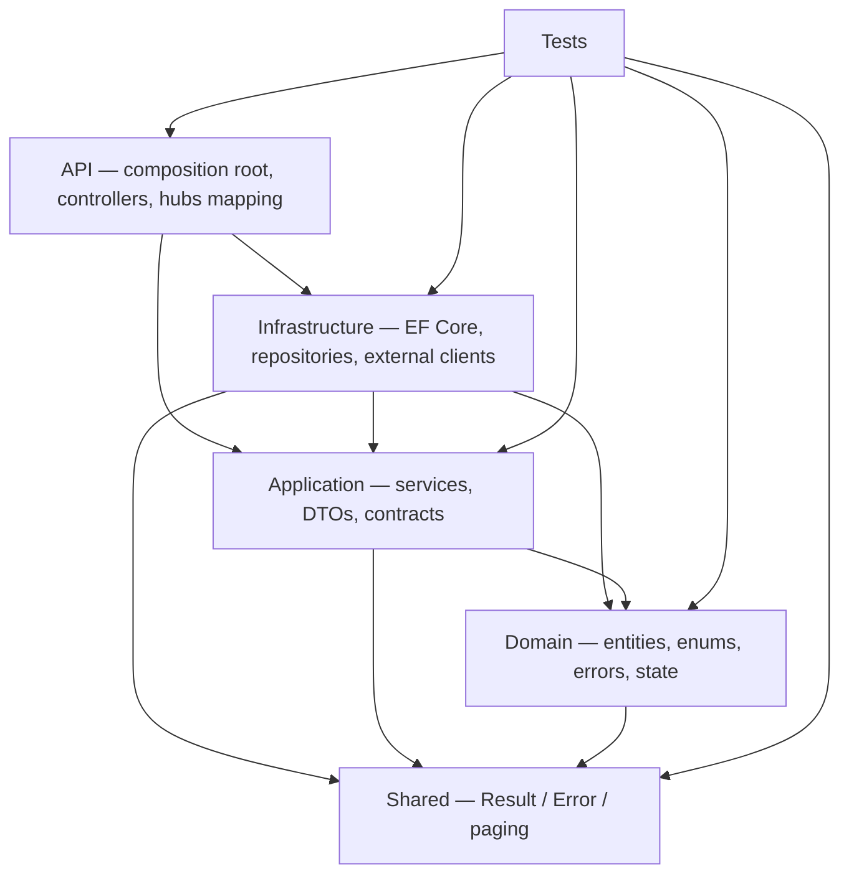
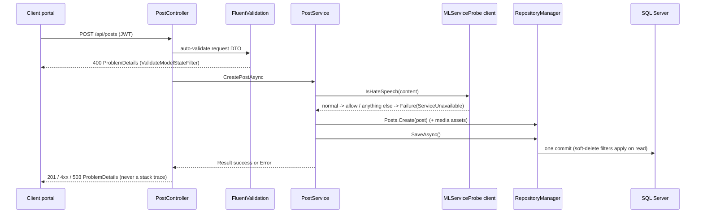

# Architecture — Nexus API

ASP.NET Core 8 Web API for the Nexus / Mental Mediator platform. Clean (Onion-shaped)
architecture, EF Core + SQL Server, SignalR for realtime, external ML service for
moderation.

Verified against the code on 2026-11-01 (`dotnet build -c Release`: 0 errors;
`dotnet test -c Release`: 230 passing). Companion documents:
[`../README.md`](../README.md) (endpoint and hosting surface),
[`KNOWN_LIMITATIONS.md`](KNOWN_LIMITATIONS.md) (what is deliberate vs deferred — this
document does not repeat it), [`DEPLOYMENT.md`](DEPLOYMENT.md),
[`RUNBOOK.md`](RUNBOOK.md), and the decision records in [`adr/`](adr/).

---

## 1. Projects and dependency direction

`MentalMediator.sln` contains six projects (the solution also defines a legacy `Somee`
build configuration).

| Project | Referenced projects | Role |
|---|---|---|
| `Domain` | `Shared` | Entities, enums, domain errors, repository interfaces, state objects |
| `Application` | `Domain`, `Shared` | Service contracts, services, DTOs + validators, options |
| `Infrastructure` | `Application`, `Domain`, `Shared` | EF Core, repositories, external clients, hubs, utilities |
| `API` | `Application`, `Infrastructure` | Controllers, pipeline, composition root |
| `Shared` | — | `Result`/`Result<T>`, `Error`, `ErrorType`, paging, `RequestParameters` |
| `Tests` (`MentalMediator.Tests`) | all five | xUnit + FluentAssertions + `EF InMemory` |

Dependencies point inward only:



Rules that follow from that graph:

- `Domain` and `Shared` depend on nothing of ours. No EF Core, no ASP.NET types.
- `Application` talks to persistence and external services **only** through interfaces
  (`Domain/Repositories/*`, `Application/Contracts/*`). It never references
  `Infrastructure`.
- `Infrastructure` implements those interfaces. `API` is the only place that wires them
  together.
- `API` referencing `Infrastructure` is deliberate: it is the composition root
  (`Program.cs` → `Configurations/DependencyInjection.cs`). Nothing else may reach across.

Abstractions live in two places, and the split is intentional: repository interfaces are
in `Domain/Repositories` (they speak in domain types), service and cross-cutting
interfaces are in `Application/Contracts` (`IRepositoryManager` composes the repository
interfaces and is consumed by services).

---

## 2. Layer responsibilities

```
API/
  Program.cs                    pipeline order, /health, /error, hub mapping, startup migration
  Configurations/               DependencyInjection.cs (all Add* extensions), Swagger, CORS,
                                MappingProfile, RateLimitPolicies, ValidateModelStateFilter,
                                CloudinaryUrlJsonConverter
  Controllers/                  18 controllers, thin: bind → call service → map Result to HTTP
  ResultExtensions.cs           Error/ErrorType → RFC 7807 ProblemDetails
  wwwroot/                      static email-confirmation pages and email templates
Application/
  Contracts/                    service interfaces + IRepositoryManager + client interfaces
                                (IHateSpeechDetector, IChatContentModerator, IStorageService, …)
  Services/                     business rules and orchestration (PostService, AppointmentService,
                                ChatService, DoctorSchedulingService, RoomAccessPolicy, …)
  Dtos/                         request/response records per domain, FluentValidation validators
  Community/                    PostTaxonomy, PostAccessPolicy (category, audience, visibility rules)
Options/ JwtOptions, MailSettings, ResendSettings
Domain/
  Entities/                     BaseUser → User / Doctor / Admin, Appointment, Post, Comment, Reply,
                                ChatRoom / ChatRoomMember / ChatMessage / ChatMessageReport,
                                Notification, DoctorAvailabilityPeriod, DoctorTimeOff,
                                DoctorSchedulingSettings, PatientNote, FollowUp, UserCertificate,
                                UserQualification, PostMediaAsset, PostLike, DepressionTestResult
  Enums/                        AppointmentStatus, PostVisibility, ChatRoomRole, ChatRoomVisibility, …
  Errors/                       static error factories per area (PostErrors, ChatErrors, …)
  Repositories/                 repository interfaces + IAppointmentBookingLock
  States/AppointmentStates/     Pending/Confirmed/Completed/Cancelled/Rejected state classes
  Value Objects/                report projections (MonthlyAppointmentCount, …)
Infrastructure/
  Data/                         AppDbContext (IdentityDbContext<BaseUser>), DbInitializer
  Configurations/               IEntityTypeConfiguration<T> per entity: tables, indexes, TPT, filters
  Repositories/                 RepositoryBase<T> + one repository per aggregate + RepositoryManager
  Services/                     AuthService, UserService, UserClaimsService, NotificationSender,
                                ChatRealtimeNotifier, PatientDirectoryLookup, StorageService
                                (= CloudinaryStorageService), MailService (MailKit SMTP),
                                ResendMailService, UserFactory
  Clients/                      MLServiceProbe, HateSpeechDetectorClient, ChatContentModerator,
                                DepressionDetectorClient, NewsApiClient, ResendClient
  Hubs/                         ChatHub, NotificationHub, IChatClient, ChatConnectionRegistry
  Caching/                      InMemoryCacheService (ICacheService)
  Utilities/                    JwtTokenGenerator, AuthHandoff, RoomPassphraseHasher, RoomJoinThrottle
  BackgroundJobs/               HostingRefresher.cs — dormant, deliberately not registered
Shared/
  Result.cs, Error.cs, ErrorType.cs, PagingExtensions.cs, RequestParameters/
```

Controller count and folder names are listed as they exist in the tree; when a name
disagrees with a document, the tree wins.

---

## 3. HTTP pipeline (Program.cs, in order)

1. `DotEnv.Load` — **only when `ASPNETCORE_ENVIRONMENT=Development`**, wrapped in
   `try/catch`. Probing for `.env` up the directory tree throws
   `UnauthorizedAccessException` under shared IIS and used to kill startup with a 500.30.
2. Service registration: `ConfigureControllers`, `ConfigureSwagger`, `ConfigureCors`,
   `ConfigureOptions`, `ConfigureDbContext`, `ConfigureIdentity`, `ConfigureAuthentication`,
   `ConfigureAuthorization`, `ConfigureRepositories`, `ConfigureAutoMapper`,
   `ConfigureServices`, `ConfigureRateLimiting`, `ConfigureCaching`, `ConfigureResend`,
   `ConfigureHttpClients`.
3. `UseForwardedHeaders` (X-Forwarded-For / X-Forwarded-Proto) — first, because IIS puts
the app behind a proxy and scheme/host must be correct before HTTPS redirection and
outbound email links read them.
4. `UseDeveloperExceptionPage` in Development, otherwise
   `UseExceptionHandler("/error")`. HSTS is deliberately not enabled.
5. `UseSwagger` + `UseSwaggerUI` — unconditional (public in production by demo decision).
6. `UseHttpsRedirection` — on by default outside Development, disabled by
   `RequireHttps=false`.
7. `UseStaticFiles` → `UseCors("Default")` → `UseAuthentication` → `UseAuthorization` →
   `UseRateLimiter` → `MapControllers`.
8. `MapHub<NotificationHub>("notification-hub")`, `MapHub<ChatHub>("chat-hub")`.
9. `MapGet("/error")` → `ProblemDetails` 500; `MapGet("/health")` →
   `{ status, service: "mental-mediator-api", time }`. `/health` touches no database and
   no external service, which is what makes it a trustworthy readiness signal.
10. `await app.InitializeDatabaseAsync()` — awaited, not `.Wait()`, to avoid a deadlock
    under the in-process IIS host.
11. `app.Run()`.

---

## 4. Key patterns

### 4.1 `Result<T>` / `Error` (no exceptions for control flow)

`Shared/Result.cs` — `Result` and `Result<T>` with `IsSuccess`/`IsFailure`/`Error`/`Value`,
static `Success`/`Failure`, implicit conversions from `T` and from `Error`, and a
constructor that refuses the inconsistent combinations (success with an error, failure
with `Error.None`).

`Shared/Error.cs` — a record carrying `Code`, `Description`, `ErrorType`, created only
through the factories `Validation`, `NotFound`, `Conflict`, `Forbidden`,
`ServiceUnavailable`, `Failure`. `Domain/Errors/*Errors.cs` turn those into
domain-specific, machine-readable codes (`"Posts.DoctorsOnlyForbidden"`,
`"Chat.RoomPassphraseIncorrect"`, …).

`API/ResultExtensions.cs` maps `ErrorType` → HTTP status: Validation → 400, Failure → 400,
NotFound → 404, Conflict → 409, Forbidden → 403, ServiceUnavailable → 503, anything
unmapped → 500. The body is RFC 7807 `ProblemDetails` with `Detail` set to the description
and the whole `Error` exposed under `extensions.errors[]`, so clients can branch on `code`.

Consequence: services return values, not exceptions; controllers stay thin; a dependency
being down (moderation, storage, mail) is a **503 with a code**, not a stack trace.

### 4.2 Repository + unit of work

- `RepositoryBase<T>` exposes `FindAll(bool trackChanges)`,
  `FindByCondition(predicate, bool trackChanges)`, `Create`, `Update`, `Delete`.
  `trackChanges` selects between the tracked set and `AsNoTracking()`; the flag is
  load-bearing and pinned by `Tests/AppointmentStatsTests.cs` (it was inverted once).
- `RepositoryManager` (`IRepositoryManager`) holds the shared `AppDbContext` and creates
  each repository lazily, so all repositories in a request share one change tracker.
  `SaveAsync()` is the single commit point (`DbContext.SaveChangesAsync`) — the unit of
  work for a request.
- Repositories return domain types or projections; queries `Include` the navigations they
  need rather than leaving composition to callers (a missing `Include` on `AppUser` caused
  a production 500 in the post feed, since fixed in all four post query sites).
- `Delete` on the base class is a real SQL delete. Accounts are **not** deleted that way —
  see §4.4.

### 4.3 Identity, TPT inheritance, soft delete

- `AppDbContext : IdentityDbContext<BaseUser>`; `UserManager`/`SignInManager`/`RoleManager`
  are bound to `BaseUser`.
- Table-per-hierarchy. The effective mapping, read from
  `Infrastructure/Migrations/AppDbContextModelSnapshot.cs`: `BaseUser` → **`AspNetUsers`**,
  `User` → `Users`, `Doctor` → `Doctors`, `Admin` → `Admins` (`UserConfiguration.cs`,
  `DoctorConfiguration.cs`, and the `Admins`/`Users`/`Doctors` tables created by the migrations).
  Note the trap: `AppUserConfiguration` asks for `ToTable("BaseUsers")`, but
  `AppDbContext.OnModelCreating` calls `ApplyConfigurationsFromAssembly` **before**
  `base.OnModelCreating(builder)`, so Identity re-asserts `AspNetUsers` and no `BaseUsers` table
  exists in any migration. Scripts and SQL must target `AspNetUsers`.
- Global query filter `HasQueryFilter(x => !x.IsDeleted)` on `BaseUser`:
  soft-deleted accounts disappear from every query by default, and EF surfaces that as
  model-validation warnings against required navigations (accepted, documented).
- `BaseUser` derives `UserName` from the email local part and overrides
  `NormalizedEmail`/`NormalizedUserName`; because `NormalizedUserName` is unique, two
  addresses sharing a local part collide. `AuthService` surfaces that as
  a 409 conflict rather than silently reusing an account.
- Account deletion is a soft delete: `UserService.DeleteUser` and `DoctorService` set
  `IsDeleted = true`. The former hard-delete `UserRepository.DeleteUser` was removed during
  stabilization, so no code path can hard-delete an account (see `Domain/Repositories/IUserRepository.cs`).

### 4.4 Appointment lifecycle (state pattern)

`Domain/Entities/Appointment.cs` keeps `Status` (`AppointmentStatus`) as the persisted
field and exposes a `[NotMapped] State` that resolves to a state object per status:
`PendingState`, `ConfirmedState`, `CompletedState`, `CancelledState`, `RejectedState`, all
implementing `IAppointmentState` (`Cancel`, `Confirm`, `Complete`, `Reject`).

Every transition returns `Result<Appointment>`; an illegal one returns
`Error.Conflict` rather than throwing (e.g. `PendingState.Complete()` →
"Cannot complete an appointment in the pending state."). The enum stays queryable and
EF-friendly while the legality rules live in the domain, not in controllers or the
portals.

### 4.5 Per-doctor booking lock (concurrency)

SQL Server has no exclusion constraint for time ranges, so slot contention is serialized
with a transaction-scoped application lock:

- `IAppointmentBookingLock` (`Domain/Repositories`) — `CommitAsync` + `IAsyncDisposable`.
- `AppointmentRepository.AcquireBookingLockAsync(doctorId)` returns
  `SqlServerAppointmentBookingLock` when `Database.IsSqlServer()`, otherwise
  `NoOpAppointmentBookingLock` (the in-memory test provider).
- The SQL implementation opens a `ReadCommitted` transaction and calls
  `sys.sp_getapplock` with `@Resource = "doctor-booking:<doctorId>"`,
  `@LockMode = 'Exclusive'`, `@LockOwner = 'Transaction'`, `@LockTimeout = 10000`;
  a negative result throws (SQL error 51000) and the transaction is rolled back and
  disposed. Because the lock is transaction-owned, a crashed request cannot leak it.
- Callers hold it across validate → insert → commit:
  `AppointmentService` (booking) and `DoctorSchedulingService` (two schedule-mutation
  paths). The pattern is: acquire lock → revalidate the slot → mutate →
  `SaveAsync()` → `CommitAsync()` → dispose.

### 4.6 Fail-closed content moderation

Every post, comment, reply and chat message is classified by the external hate-speech
model **before** it is persisted.

- `MLServiceProbe` (`Infrastructure/Clients/`) is the single transport for the model
  service. One budget covers a whole attempt sequence: `MLServer:TimeoutSeconds`
  (default 45), also applied as the named `ml-client` `HttpClient.Timeout`.
  `MLServer:MaxRetries` (default 2) is spent only on failures that answer quickly —
  transport errors and 408/429/500/502/503/504, which is what the host returns while the
  container is cold. `MLServer:RetryBackoffSeconds` (default 1) doubles per attempt and is
  skipped if it would cross the deadline. A timed-out attempt is never retried.
  Statuses: `Completed`, `TimedOut`, `Unavailable`, `InvalidResponse`.
- `HateSpeechDetectorClient` (`IHateSpeechDetector`, used by `PostService`,
  `CommentService`, `ReplyService`) accepts **only** an explicit `"normal"` prediction.
  Anything else — timeout, unreachable, non-2xx, unreadable body, blank prediction —
  returns `Error.ServiceUnavailable("ExternalServices.HateSpeechDetectionServiceUnavailable", …)`.
- `ChatContentModerator` (`IChatContentModerator`, used by `ChatService`) is the same rule
  in chat form: no decision → `ChatErrors.ModerationUnavailable()`; explicit non-normal →
  `ChatErrors.ContentRejected()`.
- `MLServerAddress` must be configured: `ConfigureHttpClients` throws at startup if it is
  missing, rather than silently shipping an unmoderated community.
- Deliberately **no keep-alive poller**: `Infrastructure/BackgroundJobs/HostingRefresher.cs`
  exists but is not registered. A cold model is absorbed inside the request budget
  (~32 s measured cold, ~0.5 s warm). See [`adr/0004`](adr/0004-fail-closed-moderation.md).
- Failures are deterministic at the boundary: a validation rejection is `Content.Forbidden`
  and is not retried; a moderation outage is 503 and the content stays unpublished.
  The probe logs the failure type and status, never the submitted text.

### 4.7 Authentication and authorization

- JWT bearer is the default scheme. `MapInboundClaims = false` with
  `RoleClaimType = "roles"` and `NameClaimType = "name"` — without that, the default
  claim mapping rewrites `roles` to the long Identity URI and every
  `[Authorize(Roles = "Doctor")]` endpoint answers 403.
- Issuance (`JwtTokenGenerator`) and validation read the same `JwtSettings` section, so
  `Issuer`/`Audience` only have to be self-consistent per environment — which is exactly
  why the deployed audience must not be "corrected" ([`adr/0002`](adr/0002-jwt-audience-per-environment.md)).
- Claims in the token: `uid`, `nameid`, `email`, `name`, `photoUrl`, `jti`, and one `roles`
  claim per Identity role.
- SignalR: the access token is read from `?access_token=` **only** for paths starting with
  `/notification-hub` or `/chat-hub`; REST still requires the `Authorization` header, and
  production request logging stays at Warning so tokens are not written to logs.
- Authentication is password-only on both portals. The Google external-login path was removed on 2026-11-01, along with `ExternalLoginProfile`, `AddGoogle` and the `/signin-google` handler callback, so there is no redirect handoff and no one-time `temporaryToken` to exchange. See the superseded [`adr:0003`](adr/0003-auth-channels-doctor-password-patient-google.md) for why it existed and what it cost.
- Authorization is server-side only: policies/roles on controllers plus per-resource checks
  inside services (`RoomAccessPolicy`, `PostAccessPolicy`, notification ownership). Frontend
  role checks are UX.
- Rate limiting (`API/Configurations/RateLimitPolicies.cs`): `auth` 10/min per IP,
  `chat-messages` 30/min per user,
  `chat-room-join` 10/5 min, `chat-reports` 10/h, `chat-room-creation` partitioned by role
  tier (5/h staff, 2/h everyone else). Rejection is a 429 `ProblemDetails` with
  `Retry-After`.
- Room passphrases are a separate credential class from account passwords:
  `IRoomPassphraseHasher` (PBKDF2-SHA256, per-room salt) and `IRoomJoinThrottle` are
  singletons, and no response ever carries the hash (`Tests/ChatRoomPrivacyTests` guards it).

### 4.8 Persistence-adjacent infrastructure

- **Migrations** live in `Infrastructure/Migrations` (chosen via
  `UseSqlServer(..., b => b.MigrationsAssembly(nameof(Infrastructure)))`).
- `DbInitializer.InitializeDatabaseAsync` runs at startup and applies **pending
  migrations only when `CanConnectAsync()` succeeds**. A missing database is never created
  implicitly, and no data is ever seeded from the application — demo data is
  `scripts/reset-demo-data.sql` + `scripts/seed.sql`, run by hand.
- Development uses `ConnectionStrings:constr`; every other environment uses
  `ConnectionStrings:constr_somee` (the historical key name is what the app reads).
- `EnableDetailedErrors`, `EnableSensitiveDataLogging` and `LogTo(Console.WriteLine)` are
  Development-only.
- **DataProtection** keys are persisted to a `keys/` folder next to the assembly
  (`AppContext.BaseDirectory`) inside a `try/catch` that downgrades to the ephemeral
  default on failure. Without this, an IIS app pool with no user profile regenerates keys
  on every restart and invalidates issued refresh cookies. `keys/` is gitignored and
  survives deploys via msdeploy's `DoNotDeleteRule`.
- **Caching**: `ICacheService` → `InMemoryCacheService` over `IMemoryCache`. Process-local,
  which is why the app runs as a single instance: the cache is per process.
- **Storage**: `IStorageService` → `CloudinaryStorageService`, configured from the
  `CLOUDINARY_URL` environment variable only. Unconfigured uploads return a controlled 503.
  Media URLs embedded in posts are validated against the managed cloud
  (`CloudinaryUrlJsonConverter`, `PostMediaAsset` ownership).
- **Email**: `IMailService` → `ResendMailService`, which falls back to `MailService`
  (MailKit SMTP) when Resend is unconfigured or refuses. The wiring is hand-written in DI
  because `ResendMailService` itself implements `IMailService` and a generic registration
  would form a resolution cycle. `RESEND_API_KEY` overrides `Resend:ApiKey`.

---

## 5. Data flow

Two representative paths.

**Moderated write (`POST /api/posts`)**



**Booking (`POST /api/appointments`)** — controller → `AppointmentService` →
`AcquireBookingLockAsync(doctorId)` (app lock + transaction) → `ValidateBookingTimeAsync`
(availability periods minus time-off minus existing appointments) → map + denormalize the
party fields → `Appointments.Create` → `SaveAsync()` → `CommitAsync()` → release →
notification row delivered through `INotificationService` / `INotificationSender` (SignalR
`NotificationHub`) → confirmation email through `IMailService`.

Side effects are ordered by reversibility: the database commit happens inside the lock, the
in-app notification is delivered after it, and the email is **best-effort after that** —
`SendAppointmentEmailAsync` logs and swallows a mail failure, because reporting it as a failed
request would tell the client the booking did not happen and invite a retry that duplicates it.

Realtime flow: hubs are mapped in `Program.cs`, authenticate with the JWT from the query
string, resolve the user through `IUserClaimsService`, and push through
`ChatRealtimeNotifier` / `INotificationSender` with connection ids tracked in the singleton
`IChatConnectionRegistry`.

---

## 6. Where new code goes

| Change | Home |
|---|---|
| Entity, enum, state rule, domain error | `Domain` |
| Service behaviour, DTO, validator, taxonomy | `Application` |
| Query, EF configuration, migration, external client, hub | `Infrastructure` |
| Route, DI registration, pipeline option, HTTP mapping | `API` |
| Cross-cutting result/paging primitive | `Shared` |
| Any rule the portals must not be trusted with | the API, and a test in `Tests/` |

Boundaries worth keeping: no `DbContext` above `Infrastructure`; no `Infrastructure` type
in `Application`; no exception thrown for a business failure that `Result` can express;
no authorization decision made only in a portal.
