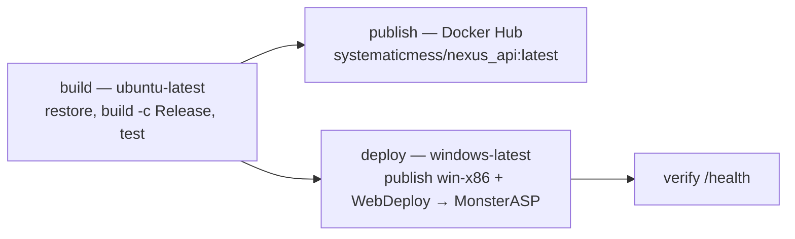

# Deployment — Nexus API

One production target: **MonsterASP** (`https://nexus-api.runasp.net`), IIS in-process,
deployed over WebDeploy from GitHub Actions. A Docker Hub image is built as a side channel
and a retired Somee free-tier host still exists; neither is on the deploy critical path.

Verified against [`.github/workflows/ci_cd_pipeline.yml`](../.github/workflows/ci_cd_pipeline.yml)
on 2026-11-01. Related: [`README.md`](../README.md) (hosting tables),
[`KNOWN_LIMITATIONS.md`](KNOWN_LIMITATIONS.md) (Somee schema drift, package advisories),
[`RUNBOOK.md`](RUNBOOK.md) (day-to-day checks),
[`deployment-diagnosis-monsterasp.md`](deployment-diagnosis-monsterasp.md) (the original
evidence-backed migration audit).

---

## 1. Pipeline shape

`ci_cd_pipeline.yml` — "Nexus API CI/CD Pipeline".

- **Triggers:** `push` to `master`, and `workflow_dispatch` with the boolean input
  `deploy_to_production` (default `true`). With the current repository variable
  `AUTO_DEPLOY_MONSTERASP=true`, **a push to `master` goes all the way to production**.
- **Concurrency:** group `nexus-api-${{ github.ref }}`, `cancel-in-progress: true` — a new
  push cancels an in-flight run rather than queueing a second deploy.
- **Permissions:** `contents: read` (no write token).
- **Job-level env:** `DOTNET_NOLOGO`, `DOTNET_CLI_TELEMETRY_OPTOUT`,
  `DOTNET_SKIP_FIRST_TIME_EXPERIENCE`.



| Job | Runner | Condition | What it does |
|---|---|---|---|
| `build` ("Build and test") | `ubuntu-latest` | always | `actions/checkout@v4`, `actions/setup-dotnet@v4` with `dotnet-version: 8.0.x`, then `dotnet restore`, `dotnet build --configuration Release --no-restore`, `dotnet test --configuration Release --no-build --verbosity normal` (271 tests) |
| `publish` ("Publish Docker image to Docker Hub") | `ubuntu-latest` | `needs: build` | `docker/login-action@v3`, `docker/setup-buildx-action@v3`, `docker/build-push-action@v5` pushing `systematicmess/nexus_api:latest` |
| `deploy` ("Publish and deploy to MonsterASP.net (WebDeploy)") | `windows-latest` | `needs: build` **and** (`workflow_dispatch` with `inputs.deploy_to_production`, **or** `push` with repo variable `vars.AUTO_DEPLOY_MONSTERASP == 'true'`); `environment: production` | publish, generate production settings, validate output, `msdeploy.exe -verb:sync`, poll `/health` |

Docker Hub is a separate channel on purpose: the live site is IIS on MonsterASP, so a
registry outage fails the `publish` job without touching the deployed site.

### Deploy sequence (the `deploy` job, step by step)

1. **Publish for IIS** (pwsh):
   ```powershell
   dotnet publish API/API.csproj `
     --configuration Release `
     --output ./publish `
     --runtime win-x86 `
     --self-contained false `
     -p:UseAppHost=false
   ```
2. **Write production appsettings** — `publish/appsettings.Production.json` is generated in
   the runner from secrets and never committed (it is gitignored). `appsettings.Development.json`
   is deleted from the publish folder. Values are read through `$env:NAME`, never inlined as
   `${{ secrets.* }}` into the script body (a quote, `$` or backtick in a value breaks the
   PowerShell parser, and inlining also risks logging).
3. **Inject runtime environment variables into `web.config`** — adds an
   `<environmentVariables>` block under `<aspNetCore>` with `ASPNETCORE_ENVIRONMENT=Production`
   and, when the secret is present, `CLOUDINARY_URL`. Shared IIS gives an app no other way to
   reach process environment variables. Missing `PRODUCTION_CLOUDINARY_URL` is not fatal: the
   step logs that uploads will return a controlled 503.
4. **Validate publish output** — fails the build unless: `publish/web.config` and
   `publish/API.dll` exist; `publish/API.exe` **does not** exist; `web.config` contains
   `processPath="dotnet"`, `hostingModel="inprocess"` and `name="ASPNETCORE_ENVIRONMENT"`;
   `publish/appsettings.Production.json` exists and every secret-backed field
   (`ConnectionStrings:constr_somee`, `JwtSettings:Key`,
   `MailSettings:Username`/`:Password`, `NewsApi:ApiKey`) is non-empty — **lengths/emptiness
   only, values are never logged**; and the publish folder is under 120 MB as a bloat gate.
5. **Deploy via WebDeploy** — locates `msdeploy.exe` on the runner, then builds the argument
   string and hands it to `ProcessStartInfo.Arguments` verbatim (PowerShell token splitting
   re-quotes the long `-dest` token and msdeploy answers "Unrecognized argument"):
   ```
   msdeploy.exe -verb:sync `
     -source:contentPath=<repo>/publish `
     -dest:contentPath=site101103,computerName=https://site101103.siteasp.net:8172/msdeploy.axd?site=site101103,userName=site101103,password=<secret>,authtype=Basic,includeAcls=False `
     -allowUntrusted -disableLink:AppPoolExtension -disableLink:ContentExtension `
     -disableLink:CertificateExtension -enableRule:AppOffline -enableRule:DoNotDeleteRule
   ```
   - `-enableRule:AppOffline` drops `app_offline.htm` for the sync, because in-process IIS
     keeps `API.dll` open and a plain content sync fails with `ERROR_FILE_IN_USE`. Staging
     that file by hand via the `filePath` provider is **not authorized** on this host
     (`ERROR_USER_NOT_AUTHORIZED_FOR_DEPLOYMENTPROVIDER`), so the rule must do it.
   - `-enableRule:DoNotDeleteRule` keeps runtime-only folders — notably the DataProtection
     `keys/` directory — alive across releases.
   - Up to 3 attempts, 15 s apart, and **only** when the output matches `FILE_IN_USE`; any
     other failure exits immediately. The command line is redacted before logging.
6. **Verify deployment** — polls `https://nexus-api.runasp.net/health` (overridable with the
   repo variable `PRODUCTION_SITE_URL`) every 15 s for up to 6 minutes, requires HTTP 200,
   then probes `/swagger/v1/swagger.json` (a swagger failure there is reported, not fatal).
   On timeout the step prints a fixed diagnosis list: files in the site root, Control Panel
   application/access logs for a 500.30-class failure, and whether
   `appsettings.Production.json` with a real connection string was uploaded.

### Why `win-x86` and `-p:UseAppHost=false`

| Flag | Reason |
|---|---|
| `--runtime win-x86` | MonsterASP's own command-line deploy docs publish `win-x86`, matching the 32-bit application pool on the free shared host |
| `-p:UseAppHost=false` | With a RID set, publish otherwise emits an apphost `API.exe` and a `web.config` pointing at it. The supported form is `dotnet API.dll` in-process |

A regression here surfaces as a red build (step 4), not as a site that stops answering.

---

## 2. Configuration written at deploy time

From the pipeline's generated `appsettings.Production.json` (values omitted by design;
secrets come from the GitHub Actions secrets below):

| Key | Value / source |
|---|---|
| `ConnectionStrings:constr_somee` | secret `PRODUCTION_CONSTR_SOMEE` (the key the app reads outside Development) |
| `ConnectionStrings:constr`, `constr_docker` | empty strings |
| `RequireHttps` | `"true"` — MonsterASP serves TLS on `*.runasp.net` |
| `JwtSettings:Issuer` | `https://nexus-api.runasp.net` |
| `JwtSettings:Audience` | `https://mental-mediator-doctor-ui-graduation-project.vercel.app` — **do not change**, see [`adr/0002`](adr/0002-jwt-audience-per-environment.md) |
| `JwtSettings:Key` | secret `PRODUCTION_JWT_KEY` |
| `JwtSettings:Duration` | `30` |
| `MailSettings` | `smtp.gmail.com:587`, `PRODUCTION_MAIL_USERNAME` / `PRODUCTION_MAIL_PASSWORD` (must be a Gmail **app password**), `SenderName = "Mental Mediator"` |
| `ClientUI` | `https://mental-health-ochre-xi.vercel.app` (patient portal production alias; the un-suffixed name belongs to a different Vercel account) |
| `DoctorUI` | `https://mental-mediator-doctor-ui-graduation-project.vercel.app` |
| `MLServerAddress` | `https://sentiment-nja5.onrender.com/` |
| `NewsApi` | `https://newsapi.org/v2/` + secret `PRODUCTION_NEWS_API_KEY` |
| Logging levels | `Default=Information`, `Microsoft=Warning`, `Microsoft.Hosting.Lifetime=Information` |

`Resend` is **not** in the generated production file; Resend is enabled by the
`RESEND_API_KEY` environment variable or an explicit `Resend:ApiKey`. Without either, mail
falls back to the MailKit SMTP path above.

---

## 3. GitHub Actions secrets and variables

**Names only. Values are never written into a document, a commit, or a log.**

Secrets read by `ci_cd_pipeline.yml`:

| Secret | Used by | Purpose |
|---|---|---|
| `PRODUCTION_CONSTR_SOMEE` | deploy | SQL Server connection string for the hosted MonsterASP database |
| `PRODUCTION_JWT_KEY` | deploy | JWT signing key (HS256, ≥32 bytes) |
| `PRODUCTION_MAIL_USERNAME` | deploy | SMTP account (Gmail) |
| `PRODUCTION_MAIL_PASSWORD` | deploy | Gmail **app** password; a normal account password is rejected with `534 5.7.9` |
| `PRODUCTION_NEWS_API_KEY` | deploy | newsapi.org key |
| `PRODUCTION_CLOUDINARY_URL` | deploy | `cloudinary://<key>:<secret>@<cloud>`; injected into generated `web.config`. **Currently configured** in repository secrets (verified 2026-11-01), so avatar and media uploads work on the host. If removed, the API still starts and everything except uploads works — uploads return a controlled 503. Rotate with `gh secret set PRODUCTION_CLOUDINARY_URL` (see `README.md`). |
| `MONSTERASP_MSDEPLOY_PASSWORD` | deploy | WebDeploy password from the Control Panel **Deploy → Visual Studio access** card (user name = site id) |
| `DOCKER_USERNAME` / `DOCKER_PASSWORD` | publish | Docker Hub login and access token |

Repository **variables** (not secrets), with the values read from the repository on 2026-11-01:

| Variable | Current value | Purpose |
|---|---|---|
| `AUTO_DEPLOY_MONSTERASP` | `true` | A push to `master` **deploys to production**. Set to `false` to make deploys manual-only |
| `PRODUCTION_SITE_URL` | `https://nexus-api.runasp.net` | Overrides the URL used by the post-deploy verification probe |

Because `AUTO_DEPLOY_MONSTERASP` is `true`, treat `master` as a deploy trigger: pushing there
runs build → test → deploy → verify against the live site.

The repository also still holds secrets this workflow does **not** read — `CLOUDINARY_URL`,
`MONSTERASP_FTP_*`, `SOMEE_FTP_*`, `WEBDEPLOY_USERNAME` / `WEBDEPLOY_PASSWORD`, `TEST`. They are
leftovers from the earlier Somee/FTP paths. Do not wire one in believing it is the production
value; the names in the table above are the ones the pipeline actually consumes.

Rules that keep secrets out of logs: pass every secret through `env:` and read it with
`$env:NAME`; validate emptiness rather than printing; redact the msdeploy password from the
echoed command line; generate `appsettings.Production.json` in the runner (gitignored, never
committed); `.env`, `API/.env`, `API/appsettings.Production.json` and `keys/` are gitignored.

Historical note (from the diagnosis doc, still an account-side action): credentials that were
committed before they were removed remain in git history; rotation belongs to the owning
consoles, not to this repository.

---

## 4. Hosting constraints (MonsterASP free plan)

| Constraint | Value | Consequence |
|---|---|---|
| App pool | 32-bit | publish `win-x86`; a 64-bit pool fails with `500.32 ANCM Failed to Load dll` |
| RAM | ~256 MB dedicated | in-process hosting only; no separate worker; be careful with large in-memory result sets and SignalR fan-out |
| Storage | 5 GB per site | framework-dependent publish is ~30 MB; the pipeline still fails above 120 MB |
| Database | 1× MSSQL, 1 GB (`db75421`) | schema-only migrations; keep data lean; demo resets are scripted, not automatic |
| WebSockets | supported | SignalR uses its default WebSocket transport with fallbacks |
| HTTPS | automatic on `*.runasp.net` | `RequireHttps=true` is safe; HSTS is still deliberately off |
| Activity | free sites need periodic visits | an untouched free site is suspended or deleted |
| Instances | one | the `ICacheService` is process-local (`IMemoryCache`), so caches do not survive a restart |

Site coordinates used by the pipeline: site id `site101103`, WebDeploy endpoint
`https://site101103.siteasp.net:8172/msdeploy.axd?site=site101103`, and the entire publish
folder lands in `/wwwroot` of that site.

**Secondary host (Somee, `nexus-api-gp.somee.com`)**: retired free-tier fallback, 32-bit
pool, 150 MB storage, HTTP only (no TLS on free subdomains), and its `Posts` table is behind
the `AddPostAudienceAndMedia` migration. It is not a deploy target; see
[`KNOWN_LIMITATIONS.md`](KNOWN_LIMITATIONS.md).

---

## 5. Readiness and the `Server` header

Use `/health` as the only readiness truth. It requires no token, performs no database
round-trip and calls no external service, so a 200 means the application really is running;
any richer probe either passes while a dependency is broken (fails open) or reports an
outage that isn't one (fails closed). Its body is `{ status, service, time }` by design —
the service name and UTC time are the whole payload, and that is intentional.

The `Server` response header identifies **which layer answered**, which is what makes a
blank-log incident diagnosable:

| `Server` header | Layer | Meaning |
|---|---|---|
| `Microsoft-HTTPAPI/2.0` | kernel `http.sys` | The app pool never started. The application's own logs stay empty. |
| `Microsoft-IIS/10.0` | IIS worker process | A worker process is alive and serving. |
| `Kestrel` (or absent) | the application | The app ran and produced the response/error — read its logs. |

`http.sys` answers before user mode, so a site in that state returns **503 for every
request**, including ones IIS would serve without the app. Note that this deployment is
**in-process**: the application runs *inside* the IIS worker process, so a healthy production
site reports `Server: Microsoft-IIS/10.0` (observed 2026-11-01 on `/health`) — the header
distinguishes "kernel only" from "worker alive", and the `/health` JSON body is what proves the
application itself is serving. `Kestrel` (or no header) means out-of-process, e.g. a local
`dotnet run`.

Cross-check with a static file that ships in `API/wwwroot`:

```bash
curl -o /dev/null -sS -w "%{http_code}\n" https://nexus-api.runasp.net/confirm-email.html
curl -sS https://nexus-api.runasp.net/health
```

A 200 on an arbitrary URL is still not proof of health — IIS can serve content before the
application ever runs. That is exactly why the pipeline's verification step polls `/health`
and not the homepage.

**Order to check when the site stops answering** (the same list the pipeline prints):

1. Did the `deploy` job actually go green? A failed deploy leaves the previous upload serving.
2. Is `MONSTERASP_MSDEPLOY_PASSWORD` current and WebDeploy *Enabled* on the Control Panel
   **Deploy → Visual Studio access** card? A stale value fails as an HTTP 401 / login refused
   from `msdeploy.axd`.
3. Did the files land in `/wwwroot` of `site101103`?
4. Is the app pool still 32-bit (`500.32` otherwise)?
5. Did the pool start? A missing .NET 8 ASP.NET Core Hosting Bundle leaves it stopped and IIS
   answers before the app runs.
6. Is `appsettings.Production.json` present with a populated `ConnectionStrings:constr_somee`?
   Blank credentials let the app start and fail on the first database call (and
   `DbInitializer` logs "Database is not reachable; skipping migrations" instead).
7. Does `web.config` still carry `ASPNETCORE_ENVIRONMENT=Production`? A hand-edited
   `web.config` that lost it drops the app back on Development defaults (and a lost
   `CLOUDINARY_URL` breaks uploads).

One startup trap already fixed and worth remembering: `DotEnv.Load(probeForEnv: true)` walks
up from the content root, hits `d:\DZHosts\LocalUser` on shared IIS, throws
`UnauthorizedAccessException` and produces a 500.30 with no application logs. `.env` loading
is now Development-only and wrapped in `try/catch`.

---

## 6. ML service cold start

Moderation is fail-closed ([`adr/0004`](adr/0004-fail-closed-moderation.md)), and the model
host sleeps when idle: the first request after a quiet period takes **~32 s** (warm requests
are ~0.5 s). Deployment does not warm it and nothing polls it.

- The single `ml-client` `HttpClient` base address is `MLServerAddress`;
  `MLServer:TimeoutSeconds` (45) is both the whole attempt budget and the per-request
  timeout, so a cold start is absorbed rather than returned as a 500.
- `MLServer:MaxRetries` (2) is spent only on quick failures (transport error or
  408/429/500/502/503/504 — what the host returns while a container starts). A timed-out
  attempt is never retried: the budget is already spent.
- `MLServer:RetryBackoffSeconds` (1) doubles per attempt and is skipped when it would cross
  the deadline.
- The model exposes no health or readiness route (`/health`, `/ping`, `/` all 404 or error),
  so warming means issuing a real prediction — see [`RUNBOOK.md`](RUNBOOK.md) §3.
- Portal request timeouts stay **above** the server budget, otherwise the browser gives up
  while the server is still working.

---

## 7. Rolling back

There is no release-history tooling on the free plan: a deploy is a content sync into
`/wwwroot`. To roll back, re-run the pipeline for a known-good commit (`workflow_dispatch`,
`deploy_to_production`), or restore files through the host's file manager. `DoNotDeleteRule`
means files added by a release are not removed by a rollback of an older package — check
`web.config` and `appsettings.Production.json` after a manual restore. Database changes are
never rolled back by a deploy: migrations are additive and forward-only, and
`InitializeDatabaseAsync` applies pending ones at startup.
