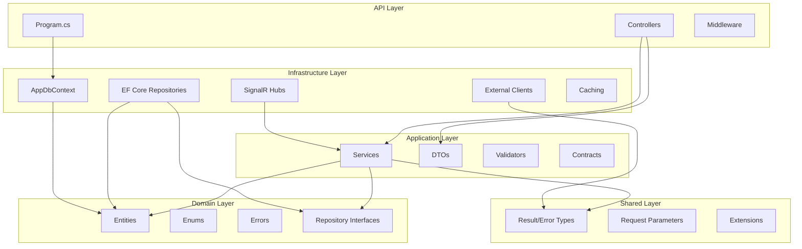

# NEXUS ENGINEERING AUDIT

**Audit Date:** October 2026  
**Auditor:** Principal Engineer (autonomous review)  
**Scope:** Full-stack healthcare/community platform (Mental Mediator / Nexus)  
**Status:** COMPLETE — Audit Only (no source files were modified)

> **Correction (2026-11-01).** This audit states in several places that the JWT
> lifetime is 30 minutes. That is wrong: `JwtTokenGenerator` calls `AddDays(30)`, so
> tokens live **30 days**. A live token was decoded and had exactly 30.0 days remaining
> at issue. This makes the SEC-002 / SEC-005 XSS token-theft findings **materially
> worse** than written here, not better. Everything else in this audit was checked
> against the code during the stabilization pass and still holds. See
> `../KNOWN_LIMITATIONS.md`.

---

## A. Executive Summary

Nexus is a full-stack healthcare/community platform built as an ASP.NET Core 8 Web API backend with two independently deployed React portals (Doctor and Patient). The codebase demonstrates a clear evolution from a graduation project to a substantial portfolio effort, with strong attention to security and correctness in several key areas, but with several critical production risks that must be addressed before considering the system ready for sustained operation.

### Strongest Architectural Decisions

1. **Clean layered architecture with dependency inversion** — The API, Application, Domain, Infrastructure, and Shared layers maintain a disciplined dependency direction. Domain entities and repository interfaces live in `Domain/`; infrastructure implementations live in `Infrastructure/`. No circular dependencies were found.
2. **Per-doctor distributed booking lock** — The appointment booking flow uses a SQL Server application lock (`SqlConnection.GetLock`) scoped per-doctor to serialize concurrent slot reservations. This correctly prevents double-booking under the `READ_COMMITTED` isolation level.
3. **Proactive ML content moderation** — Posts and comments are checked against a hosted moderation model before persistence. The `HateSpeechDetectorClient` is resilient to network failures (returns `false`-is-hate-speech on timeout), avoiding false positives while blocking clear violations.
4. **Cloudinary upload URL allowlist** — `PostService.ResolveMediaAsync` validates that every media URL resolves to the project's own Cloudinary cloud, preventing arbitrary image embedding (stored-XSS via external URLs).
5. **Ownership enforcement in service layer** — Post, comment, notification, appointment, and chat operations all verify `AppUserId == currentUserId` (or role-based overrides for Admin/Doctor moderators) inside the service layer, not just at the controller level.
6. **Rate-limited auth endpoints** — Registration, sign-in, password reset, and OAuth handoff are all backed by fixed-window rate limiters keyed on IP address, mitigating brute-force and enumeration attacks.
7. **OAuth handoff via IMemoryCache** — Google OAuth authentication completes via a 2-minute temporary token stored in `IMemoryCache`, avoiding the complexity of persistent state while bounding the exposure window.
8. **Soft-delete-aware TPT inheritance** — The `BaseUser` / `User` (Client) / `Doctor` / `Admin` TPT hierarchy with `IsDeleted` / `DeletedAt` columns shows intentional data modeling.

### Most Concerning Weaknesses

1. **Swagger UI exposed in production** — `app.UseSwagger()` and `app.UseSwaggerUI()` are called unconditionally in `Program.cs` (lines 78–80), not gated behind `IsDevelopment()`. The full API schema — including auth, booking, and moderation endpoints — is publicly discoverable.
2. **RepositoryBase tracking parameter is inverted** — `FindByCondition(filter, trackChanges)` returns `AsNoTracking()` when `trackChanges=true` and returns a tracked query when `trackChanges=false`. Every consumer that passes `true` (expecting tracking) gets no tracking; every consumer that passes `false` (expecting no tracking) gets tracking. This is a systemic data-access bug affecting all repositories.
3. **JWT tokens stored in browser localStorage** — Both portals store the JWT bearer token in `localStorage`, which is accessible to any JavaScript running in the page context. This exposes all users to token theft via XSS. No refresh-token mechanism exists, so a 30-minute expiry provides no graceful renewal path.
4. **CORS policy includes unverified third-party origins** — The CORS allowlist includes Vercel preview deployments from multiple unrelated projects (`mental-health-ochre.vercel.app`, `mental-health-b2uehhu7l-rana-tareks-projects.vercel.app`, `nexus-admin-panel.vercel.app`, `mental-health-drab.vercel.app`) whose ownership cannot be verified from the repository. Combined with `AllowCredentials()`, any XSS or subdomain takeover on those origins can act as a credentialed proxy.
5. **Startup blocked on synchronous database initialization** — `Program.cs` line 126 calls `app.InitializeDatabaseAsync().Wait()`, a synchronous `.Wait()` on an async method. This can deadlock in certain hosting contexts (IIS shared hosting with ASP.NET Core Module) and blocks the first request from completing until migrations succeed.

### Highest-Risk Security Findings

| ID | Risk | Severity |
|---|---|---|
| SEC-001 | RepositoryBase inverted `trackChanges` logic (systemic) | P1 |
| SEC-002 | JWT in localStorage — no HttpOnly cookie, no refresh token | P1 |
| SEC-003 | CORS allows unverified third-party origins with credentials | P1 |
| SEC-004 | Swagger UI exposed in production | P1 |
| SEC-005 | HTTPS redirection opt-in — production can serve HTTP | P1 |
| SEC-006 | Query-string JWT for SignalR (logged in server/proxy/browser history) | P2 |
| SEC-007 | Email confirmation links via query parameter | P2 |

### Biggest Performance Opportunities

| ID | Opportunity | Expected Impact |
|---|---|---|
| PERF-001 | N+1 `PopulateLikeState` — one DB query per post in a listing | O(N) queries → 1 query per post listing page |
| PERF-002 | `GetDoctorStats` loads all appointments into memory instead of SQL aggregate | Reduces memory from O(N) to O(1) per dashboard load |
| PERF-003 | `GetDoctorAppointmentCounts` performs in-memory GROUP BY | O(N) query → single grouped query |
| PERF-004 | `RepositoryBase` inverted tracking causes all reads to track entities | Reduces unnecessary change-tracking overhead on every read query |

### Most Important Cross-Application Inconsistencies

| Area | Doctor Portal | Patient Portal | Risk |
|---|---|---|---|
| Auth flow | Password sign-in → JWT in localStorage | Google OAuth → JWT in localStorage | Same token storage, same XSS exposure |
| Profile API | FormData (PascalCase) → `/api/doctors/me` | JSON (camelCase) → `/api/profiles/me` | Two profile edit endpoints, inconsistent field names |
| Token expiry handling | No refresh — silent 401 after 30 min | No refresh — silent 401 after 30 min | Both portals lose session without warning |
| Notification read model | Same SignalR hub | Same SignalR hub | Consistent (good) |
| Room list filtering | `GetRooms` (member-only) | `BrowseRooms` (public) | Consistent (good) |

### Areas Requiring Human Decisions

1. Whether to migrate JWT storage to HttpOnly cookies (breaks existing portal token handling, requires backend CORS/CSRF redesign)
2. Whether to retire the legacy MailKit SMTP fallback or keep it (Resend is the active provider)
3. Whether to enforce HTTPS in production (Somee free tier does not support certificates on free subdomains)
4. Whether to retire abandoned CORS origins (may break stale bookmarked deployments)
5. Whether to add a shared TypeScript types package between the two portals

---

## B. Architecture Overview

### Repository Inventory

| Repository | Owner | Deploy Target | Purpose |
|---|---|---|---|
| `mental-mediator-api-graduation-project` | alaaebrahim0 (GitHub) | Render / Somee / RunASP | ASP.NET Core 8 Web API |
| `mental-mediator-doctor-ui-graduation-project` | alaaebrahim0 (GitHub) | Vercel | React doctor portal |
| `mental-mediator-patient-ui-graduation-project` | alaaebrahim0 (GitHub) | Vercel | React patient portal |
| `shared-ui` | (local, vendored) | — | Shared React components (vendored copy, not a package dependency) |

### Application Responsibilities

```
┌─────────────────────────────────────────────────────────────────────┐
│                        API (ASP.NET Core 8)                         │
│  ┌────────┐  ┌───────────┐  ┌──────────┐  ┌─────────────┐  ┌─────┐ │
│  │  API   │  │Application│  │  Domain  │  │Infrastructure│  │Shared│ │
│  │Control-│  │Services   │  │Entities │  │  (EF repos,  │  │Error│ │
│  │ lers   │  │DTOs,     │  │Enums    │  │  Hubs,       │  │Result│ │
│  │        │  │Validators│  │Errors   │  │  HttpClients)│  │types│ │
│  └────────┘  └───────────┘  └──────────┘  └─────────────┘  └─────┘ │
│         │         │              │                │        │        │
│         └─────────┴──────────────┴────────────────┴────────┘        │
│                            Dependency ↓                            │
│         ┌─────────┐   ┌──────────┐   ┌──────────┐   ┌───────────┐   │
│         │ SQL Server│   │Cloudinary│   │  Resend  │   │  Google   │   │
│         │ (TPT)    │   │(Media)   │   │(Email)   │   │ OAuth, AI │   │
│         └─────────┘   └──────────┘   └──────────┘   └───────────┘   │
└─────────────────────────────────────────────────────────────────────┘
         │                                   │
         ▼                                   ▼
  ┌─────────────┐                 ┌─────────────────┐
  │Doctor Portal│                 │Patient Portal   │
  │(React/Vite) │                 │(React/Vite)      │
  │localStorage │                 │localStorage      │
  │JWT          │                 │JWT               │
  └─────────────┘                 └─────────────────┘
         │                                   │
         ▼                                   ▼
   ┌─────────┐                      ┌──────────────┐
   │SignalR  │ ◄────────────────────►│SignalR       │
   │Hub      │   Real-time chat &    │Hub           │
   │(JWT via  │   notifications       │(JWT via      │
   │query str)│                      │query str)      │
   └─────────┘                      └──────────────┘
```

### Backend Layers



### Database Interaction Patterns

- **TPT Inheritance**: `BaseUser` → `User` (Client) and `Doctor` (Admin also under BaseUser). Each subclass has its own table.
- **Soft Delete**: Entities have `IsDeleted` / `DeletedAt` columns with query filters, but `RepositoryBase.Delete` performs hard deletes (see DB-004).
- **Projections**: Most repository `GetById` / `GetAll` methods use `.Select()` to materialize lightweight DTO-shaped entities, bypassing full entity tracking.
- **Appointments**: The `Appointment` entity denormalizes `DoctorName`, `DoctorEmail`, `ClientName`, `ClientEmail`, `DoctorPhotoUrl`, `ClientPhotoUrl` — these are copied at creation time and never re-synced when the user's profile changes.

### Authentication & Authorization Flow

```
1. Sign-in / Google OAuth → AuthService generates JWT (30 min expiry)
2. JWT returned to frontend → stored in localStorage
3. Frontend sends `Authorization: Bearer <token>` with each API request
4. JWT middleware validates issuer, audience, signature, lifetime
5. Role claims ("Doctor", "User", "Moderator", "Admin") drive [Authorize(Roles=...)]
6. SignalR connections pass JWT via `?access_token=` query parameter
7. OAuth handoff: Google → callback → temporary token in IMemoryCache → /exchange-token → JWT
```

### Deployments

| Environment | API | Doctor UI | Patient UI | DB |
|---|---|---|---|---|
| Production | `nexus-api.runasp.net` (Render + Somee fallback) | `vercel.app` (verified) | `mental-health-ochre-xi.vercel.app` | Somee SQL Server (7.7MB / 30MB) |
| Staging | `nexus-api-gp.somee.com` | Vercel preview | Vercel preview | LocalDB |
| Local Dev | `localhost` | `localhost:5173` | `localhost:5001` | LocalDB `(LocalDB)\MSSQLLocalDB` |

**Production note**: The live API at `nexus-api.runasp.net` returns HTTP 500 on `/api/posts` due to schema drift — the committed migrations do not match the production database state.

---

## C. Findings Register

| ID | Category | Severity | Priority | Location | Problem | Recommended Fix | Effort |
|---|---|---|---|---|---|---|---|
| API-001 | Configuration | **P1** | High | `Program.cs:78-80` | Swagger UI exposed unconditionally in production | Gate `UseSwagger`/`UseSwaggerUI` behind `IsDevelopment()` | Small |
| SEC-001 | Data Access | **P1** | High | `RepositoryBase.cs:20-37`<br>`IRepositoryBase.cs` | `FindByCondition`/`FindAll` tracking logic is inverted: `trackChanges=true` → `AsNoTracking()` | Fix the ternary condition | Small |
| INF-001 | Startup | **P1** | High | `Program.cs:126` | `InitializeDatabaseAsync().Wait()` blocks startup synchronously | Use async lifecycle / health-check pattern | Medium |
| SEC-002 | Auth/Frontend | **P1** | High | `doctor-ui`, `patient-ui` | JWT stored in `localStorage` — XSS token theft | Migrate to HttpOnly cookies + refresh tokens | Large |
| SEC-003 | CORS | **P1** | High | `DependencyInjection.cs:51-57` | Untrusted third-party origins in CORS allowlist with `AllowCredentials()` | Remove unverified origins; document a rotation process | Small |
| SEC-004 | Auth | **P1** | High | `Program.cs:87-91` | HTTPS redirection gated behind `RequireHttps=true` config | Enforce HTTPS in production; document Somee limitation | Small |
| PERF-001 | Query | **P2** | High | `PostService.cs:347-352` | N+1: `PopulateLikeState` fires one query per post in a listing | Batch like-state query in a single `IN` query | Medium |
| DB-001 | Query | **P1** | High | `AppointmentRepository.cs:319-329` | `GetDoctorStats` loads all appointments into memory; no SQL aggregate | Replace with `SUM()` + `COUNT()` + `WHERE Status` | Small |
| DB-002 | Query | **P2** | Medium | `AppointmentRepository.cs:339-365` | `GetDoctorAppointmentCounts` loads all rows for in-memory GROUP BY | Move to SQL `GROUP BY` | Small |
| DB-003 | Business Logic | **P1** | High | `AppointmentRepository.cs:325-326` | `totalProfit = Sum(Fees)` includes cancelled/rejected appointments | Filter `WHERE Status = Completed` | Small |
| INT-001 | Reliability | **P1** | High | `PostService.cs:64-73`<br>`CommentService.cs:64-73` | ML moderation failure (HateSpeechDetector returns error) → content creation blocked | Degrade gracefully: log, allow, flag for manual review | Small |
| API-002 | REST Design | **P2** | Medium | All controllers | No API versioning | Add URL-path or header-based versioning | Medium |
| SEC-005 | Auth | **P1** | High | `doctor-ui/src/api/auth.api.js` | No refresh token; 30-min JWT expiry with no renewal path | Implement refresh-token flow | Large |
| SEC-006 | Auth/Frontend | **P2** | Medium | `DependencyInjection.cs:464-478` | SignalR JWT passed via query string | Use `Authorization` header with `AddHttpParsedQuery` transport | Medium |
| SEC-007 | Auth | **P2** | Medium | `AuthController.cs:198` | Email confirmation redirects with token in URL (browser history) | POST body or fragment-based token | Small |
| ARCH-001 | Architecture | **P2** | Medium | `RepositoryBase.cs:56-58` | `Delete` hard-deletes; entities have soft-delete columns | Implement soft-delete in `RepositoryBase` | Medium |
| PERF-002 | Code Quality | **P2** | Medium | All repositories | Duplicate `.Select()` projection code across methods (e.g. `AppointmentRepository` lines 71-90, 127-146, 234-253) | Introduce a shared projection mapper | Medium |
| CONS-001 | Frontend | **P2** | Medium | `doctor-ui/src/api/auth.api.js` vs `patient-ui/src/api/profile.api.js` | Doctor UI sends `FormData` with PascalCase keys; patient UI sends JSON with camelCase | Standardize on JSON + camelCase | Medium |
| INT-002 | Reliability | **P2** | Medium | `ResendMailService.cs:57-63` | `CancellationToken.None` hard-coded on Resend API call | Propagate request cancellation token | Small |
| DEPLOY-001 | Deployment | **P1** | High | Production (Somee) | `/api/posts` returns 500 — schema drift between committed migrations and production DB | Audit migration state; apply pending migrations | Medium |
| CODE-001 | Repo Hygiene | **P3** | Low | Repo root | `output.txt` (19KB Windows folder listing) tracked in git | Remove from git; add to `.gitignore` | Small |
| SEC-008 | Secrets | **P2** | Medium | `DependencyInjection.cs:255-260` | DataProtection keys persisted to `AppContext.BaseDirectory/keys/` — inside web root if misconfigured | Document explicit non-wwwroot path; verify `keys/` is outside `wwwroot/` | Small |
| SEC-009 | Info Disclosure | **P3** | Low | `Program.cs:119-124` | `/health` returns service name + server time | Keep for monitoring; consider returning only HTTP 200 | Small |
| CODE-002 | Code Quality | **P3** | Low | All services | Role checks use magic strings (`"Doctor"`, `"Admin"`, `"User"`) | Introduce typed role constants | Small |
| ARCH-002 | DI | **P3** | Low | `DependencyInjection.cs:204` | `ClaimsPrincipal` registered as scoped — unusual, can cause stale claims | Consider `IHttpContextAccessor` for claim resolution | Small |
| PERF-003 | Caching | **P3** | Low | `InMemoryCacheService.cs` | In-memory cache with no size-based eviction policy | Add `SizeLimit` + `Size` per entry | Small |
| DB-004 | Data Integrity | **P2** | Medium | `UserConfiguration.cs` | `BaseUser.IsDeleted` query filter, but `RepositoryBase.Delete` hard-deletes — inconsistent lifecycle | Decide: soft-delete everywhere or remove soft-delete filters | Medium |
| DB-005 | Indexing | **P2** | Medium | `PostConfiguration.cs` | Missing full-text or composite index on `Title`/`Content` for search | Add full-text index or `Contains` index | Medium |
| ARCH-003 | Architecture | **P2** | Medium | `AppointmentService.cs:26-38` | `AppointmentService` constructor takes 10 dependencies — SRP violation | Extract notification/email composition into a dedicated collaborator | Medium |
| SEC-010 | Auth | **P2** | Medium | `JwtTokenGenerator.cs` | JWT `Duration` is 30 minutes (configurable) — no refresh; long-lived sessions require re-auth | Implement refresh token with sliding expiry | Large |
| FE-001 | Frontend | **P3** | Low | `doctor-ui/src/context/`, `patient-ui/src/api/` | Inconsistent error normalization between portals | Share error-handling utility | Small |
| SEC-011 | Input Validation | **P2** | Medium | `PatientController`/unknown | Need to verify all controllers validate input via FluentValidation | Audit all `[FromBody]` parameters for validators | Medium |
| DEPLOY-002 | Deployment | **P2** | Medium | `docker-compose.yml`, `Dockerfile` | Docker deployment config exists but may not match Render/Somee topology | Document Docker usage vs cloud deployment | Small |

---

## D. Detailed Findings

### API-001 — Swagger UI Exposed in Production
- **Severity:** P1 (High)
- **Location:** `api/API/Program.cs:78-80`
- **Current code:**
  ```csharp
  app.UseSwagger();
  app.UseSwaggerUI(c =>
      c.SwaggerEndpoint("/swagger/v1/swagger.json", "TestApiJWT v1"));
  ```
- **Problem:** `UseSwagger()` and `UseSwaggerUI()` are called unconditionally — there is no `if (app.Environment.IsDevelopment())` guard. In production, anyone can navigate to `/swagger` and discover the full API surface, including auth endpoints (`/api/auth/signin`, `/api/auth/external-login`), appointment endpoints, and chat room management endpoints. This facilitates targeted attack planning.
- **Failure scenario:** An attacker discovers the API schema, identifies the `/api/auth/signin` endpoint, and launches a targeted brute-force or credential-stuffing campaign. They also discover the `/api/admins/summary` endpoint and probe for admin-role escalation.
- **Recommended fix:** Wrap both calls in `if (app.Environment.IsDevelopment())` or a feature-flag check. In production, expose OpenAPI spec via a separate, authenticated endpoint if needed.
- **Files affected:** `api/API/Program.cs`
- **Effort:** Small

### SEC-001 — RepositoryBase Tracking Logic is Inverted
- **Severity:** P1 (High)
- **Location:** `api/Infrastructure/Repositories/RepositoryBase.cs:20-37`
- **Current code:**
  ```csharp
  public IQueryable<T> FindAll(bool trackChanges)
  {
      return
          !trackChanges ?
          _dbContext.Set<T>() :
          _dbContext.Set<T>().AsNoTracking();
  }

  public IQueryable<T> FindByCondition(Expression<Func<T, bool>> conition, bool trackChanges)
  {
      return
          !trackChanges ?
          _dbContext.Set<T>().Where(conition) :
          _dbContext.Set<T>().Where(conition).AsNoTracking();
  }
  ```
- **Problem:** The ternary is inverted. When `trackChanges=true` (caller wants tracking), `!trackChanges` is `false`, so the `AsNoTracking()` branch executes — returning an untracked query. When `trackChanges=false` (caller does NOT want tracking), `!trackChanges` is `true`, so the tracked branch executes — returning a tracked query.

  Every caller that passes `true` (typically for updates: `GetById(id, true)`) gets `AsNoTracking()`, making the entity untracked. Every caller that passes `false` (typically for reads: `GetAll(parameters, false)`) gets full tracking, wasting memory and CPU.

  Most callers then follow up with `.Select()` projections, which create new untracked objects regardless — masking the bug. However, callers that use `.Include()` + `.FirstOrDefaultAsync()` WITHOUT `.Select()` (e.g., `UserRepository.GetById`) are directly affected.
- **Failure scenario:** A read-heavy endpoint (e.g., `GetDoctors`) loads 100 doctors with `trackChanges=false`. Due to the inversion, these 100 entities are tracked by the `DbContext`. On `SaveChanges()`, EF Core's change tracker iterates all 100 entries — unnecessary overhead. If any are accidentally modified, they would be persisted unintentionally.
- **Recommended fix:** Correct the ternary:
  ```csharp
  return trackChanges ? _dbContext.Set<T>() : _dbContext.Set<T>().AsNoTracking();
  ```
  Apply to both `FindAll` and `FindByCondition`.
- **Files affected:** `api/Infrastructure/Repositories/RepositoryBase.cs`, `api/Infrastructure/Contracts/IRepositoryBase.cs`
- **Verification:** Run existing unit tests (they should still pass since most queries use `.Select()` projections). Add a test that verifies `trackChanges=true` returns a tracked entity and `trackChanges=false` returns an untracked entity.
- **Effort:** Small

### INF-001 — Synchronous Database Initialization Blocks Startup
- **Severity:** P1 (High)
- **Location:** `api/API/Program.cs:126`
- **Current code:**
  ```csharp
  app.InitializeDatabaseAsync().Wait();
  ```
- **Problem:** `.Wait()` on an async method during startup can deadlock in contexts that use a `SynchronizationContext` (e.g., IIS with ASP.NET Core Module in-process mode). Even when it doesn't deadlock, it blocks the host from accepting requests until migrations complete. If the database is unreachable (common in shared hosting), the app fails to start.
- **Failure scenario:** On Somee's shared IIS hosting, the app pool starts, calls `InitializeDatabaseAsync().Wait()`, which attempts a database connection. If the connection is slow or the database is under maintenance, the entire application remains unavailable. If a `SynchronizationContext` is present, the `.Wait()` deadlocks and the app crashes with `500.30` (ASP.NET Core app failed to start).
- **Recommended fix:** Use `IHost.ApplicationServices` with a hosted service or `app.Lifecycle.ApplicationStarted.Register(...)` pattern. Alternatively, replace with a health-check endpoint that verifies migration state. Since this is a graduation portfolio project, a simpler approach is to wrap in `Task.Run(() => app.InitializeDatabaseAsync()).GetAwaiter().GetResult()` to avoid the `SynchronizationContext` deadlock, or use `async Main`.
- **Files affected:** `api/API/Program.cs`
- **Effort:** Small (async Main migration) / Medium (hosted service)

### SEC-002 — JWT Stored in localStorage (XSS Token Theft)
- **Severity:** P1 (High)
- **Location:** `doctor-ui/src/api/client.js` (axios token interceptor), `patient-ui/src/auth/authProvider.js`
- **Problem:** Both portals store the JWT bearer token in `localStorage` via JavaScript. `localStorage` is accessible to any script running in the page context. If any XSS vulnerability exists in either portal (or in a third-party script), the attacker can steal the JWT and impersonate the user indefinitely until the token expires. There is no refresh-token mechanism, so the 30-minute expiry is the only limiting factor.
- **Failure scenario:** A dependency in the patient portal has a known XSS vulnerability. An attacker crafts a URL that injects a script. The script calls `localStorage.getItem('token')`, sends it to the attacker's server, and the attacker uses the stolen token to book appointments, read messages, and access private health data for 30 minutes.
- **Recommended fix:** (1) Store JWT in an HttpOnly, Secure, SameSite=Strict cookie. (2) Implement a refresh-token flow to avoid requiring user interaction on expiry. (3) Add the `Authorization` header to CORS-exposed headers in the backend. (4) Ensure CSRF protection (double-submit cookie or anti-CSRF token).
- **Files affected:** `doctor-ui/src/api/client.js`, `patient-ui/src/auth/authProvider.js`, `api/API/Program.cs` (CORS config), `api/Application/Services/AuthService.cs` (token issuance)
- **Regressions risk:** This changes the token transport mechanism; both portals' auth logic must be updated simultaneously.
- **Effort:** Large

### SEC-003 — CORS Allows Untrusted Third-Party Origins
- **Severity:** P1 (High)
- **Location:** `api/API/Configurations/DependencyInjection.cs:44-68`
- **Current allowlist:**
  ```
  "https://mental-health-ochre.vercel.app",         // patient portal (foreign account)
  "https://mental-health-ochre-xi.vercel.app",      // patient portal (current production)
  "https://mental-mediator-doctor-ui-graduation-project.vercel.app",
  "https://mental-mediator-doctor-ui-graduation-project-lms6panp1.vercel.app",
  "https://mental-health-b2uehhu7l-rana-tareks-projects.vercel.app",
  "https://nexus-admin-panel.vercel.app",
  "https://mental-health-drab.vercel.app",
  ```
- **Problem:** The comment on line 47 explicitly states: *"The next origin is NOT owned by this project: the name resolves to a different Vercel account and 302s to their login page."* Despite this acknowledgment, the origin remains in the allowlist. Combined with `AllowCredentials()`, any XSS or subdomain-takeover on these origins can make credentialed cross-origin requests to the API. Several of these origins (`mental-health-drab.vercel.app`, `nexus-admin-panel.vercel.app`) appear to be abandoned preview deployments with unknown ownership.
- **Failure scenario:** A Vercel preview deployment from the `mental-health-drab` project goes unmaintained. Vercel's default domain is compromised or an old build with an XSS vulnerability is still served at that URL. Since it's in the CORS allowlist with `AllowCredentials()`, a script on that page can call the API as the authenticated user.
- **Recommended fix:** (1) Remove all origins not verified as belonging to this project. (2) Replace the static allowlist with an environment-variable-driven allowlist that can be updated without a code deploy. (3) Document a rotation process for stale origins.
- **Files affected:** `api/API/Configurations/DependencyInjection.cs`
- **Effort:** Small

### SEC-004 — HTTPS Redirection Opt-In
- **Severity:** P1 (High)
- **Location:** `api/API/Program.cs:87-91`
- **Current code:**
  ```csharp
  if (string.Equals(builder.Configuration["RequireHttps"], "true",
                   StringComparison.OrdinalIgnoreCase))
  {
      app.UseHttpsRedirection();
  }
  ```
- **Problem:** HTTPS redirection is opt-in via configuration. In production, if `RequireHttps` is not set to `"true"` (which is likely the case on free-tier hosting like Somee), the API serves over plain HTTP. JWTs and user data travel in cleartext, visible to any network observer (Wi-Fi, ISP, proxy).
- **Failure scenario:** The API is deployed to Somee's free tier without HTTPS. A patient on the same hotel Wi-Fi network sends their JWT in the `Authorization` header over HTTP. A network attacker captures the token and gains access to the patient's medical appointments, chat messages, and community posts.
- **Recommended fix:** Document the hosting constraint explicitly (Somee free tier does not issue certificates). For any host that supports HTTPS (Render, RunASP), set `RequireHttps: "true"`. For Somee, document that HTTPS is not available on the free tier and users should be warned. Consider using a reverse proxy (Cloudflare, nginx) in front of Somee.
- **Files affected:** `api/API/Program.cs`, `api/API/appsettings.Example.json`
- **Effort:** Small (documentation + config) / Large (reverse proxy setup)

### PERF-001 — N+1 Like-State Queries in Post Listings
- **Severity:** P2 (Medium)
- **Location:** `api/Application/Services/PostService.cs:347-352`
- **Current code:**
  ```csharp
  private async Task PopulateLikeState(IEnumerable<Post> posts, IEnumerable<PostResponse> responses)
  {
      var responseById = responses.ToDictionary(x => x.Id);
      foreach (var post in posts)
          if (responseById.TryGetValue(post.Id, out var response)) 
              await PopulateLikeState(post, response);
  }
  ```
  Each call to `PopulateLikeState(Post post, PostResponse response)` invokes `_repos.Posts.GetLikeState(post.Id, userId)` — a separate database query.
- **Problem:** For a page of N posts, the listing endpoint fires 1 + N database queries. With the default page size, this is 11+ queries per page load.
- **Failure scenario:** The community page loads 10 posts. The frontend renders the page, then 10 sequential database queries fire. Each query adds ~50–200ms of latency. The total page load is 1–2 seconds, and under load the database connection pool is exhausted.
- **Recommended fix:** Modify `IPostRepository` to add a batch method: `GetLikeStates(IEnumerable<int> postIds, string userId)` that returns a `Dictionary<int, (int count, bool liked)>` using a single SQL query with `WHERE PostId IN (...)` and conditional aggregation.
- **Files affected:** `api/Application/Services/PostService.cs`, `api/Domain/Repositories/IPostRepository.cs`, `api/Infrastructure/Repositories/PostRepository.cs`
- **Effort:** Medium

### DB-001 — GetDoctorStats Loads Entire Appointment History
- **Severity:** P1 (High)
- **Location:** `api/Infrastructure/Repositories/AppointmentRepository.cs:319-329`
- **Current code:**
  ```csharp
  public async Task<(int totalAppointments, decimal totalProfit)> GetDoctorStats(string doctorId)
  {
      var result = await FindByCondition(x => x.DoctorId == doctorId, false)
          .Select(x => new { x.Fees, x.Status })
          .ToListAsync();
      var totalAppointments = result.Count();
      var totalProfit = result.Sum(x => x.Fees);
      return (totalAppointments, totalProfit);
  }
  ```
- **Problem:** This method loads every appointment for a doctor into memory, then uses LINQ-to-Objects to count and sum. For a doctor with 5,000 appointments, this materializes 5,000 objects. Additionally, there's no database index on `(DoctorId, Status)` for filtering — the existing `(DoctorId, StartTime, Status)` index can help but doesn't cover the query well.

  **Critical business logic flaw:** `totalProfit` sums `Fees` across ALL appointment statuses, including `Cancelled`, `Rejected`, and `Pending`. A "profit" metric should only include `Completed` appointments.
- **Failure scenario:** The doctor workspace dashboard calls `GetDoctorStats` for a doctor with 3,000 completed appointments and 200 cancelled ones. The query loads 3,200 rows into memory, all are counted, and all fees (including cancelled appointment fees) are summed — reporting inaccurate financial data.
- **Recommended fix:**
  ```sql
  SELECT COUNT(*), SUM(Fees) 
  FROM Appointments 
  WHERE DoctorId = @doctorId AND Status = 'Completed'
  ```
  Implemented as a single `CountAsync` + `SumAsync` query.
- **Files affected:** `api/Infrastructure/Repositories/AppointmentRepository.cs`, `api/Domain/Repositories/IAppointmentRepository.cs`
- **Effort:** Small

### DB-002 — GetDoctorAppointmentCounts In-Memory GROUP BY
- **Severity:** P2 (Medium)
- **Location:** `api/Infrastructure/Repositories/AppointmentRepository.cs:339-365`
- **Problem:** This method calls `.ToListAsync()` on the entire doctor's appointment history, then does `GroupBy(x => x.StartTime.DayOfWeek)` and `GroupBy(x => x.StartTime.Month)` in C# memory. A SQL `GROUP BY` with `COUNT(*)` would produce the same result with a single aggregate query returning at most 7 + 12 rows.
- **Recommended fix:** Two aggregate queries:
  ```sql
  SELECT DATEPART(WEEKDAY, StartTime) AS Day, COUNT(*) 
  FROM Appointments WHERE DoctorId = @id GROUP BY DATEPART(WEEKDAY, StartTime)
  ```
  ```sql
  SELECT MONTH(StartTime) AS Month, COUNT(*) 
  FROM Appointments WHERE DoctorId = @id GROUP BY MONTH(StartTime)
  ```
- **Files affected:** `api/Infrastructure/Repositories/AppointmentRepository.cs`
- **Effort:** Small

### DB-003 — Profit Calculation Includes Cancelled/Rejected Appointments
- **Severity:** P1 (High)
- **Location:** `api/Infrastructure/Repositories/AppointmentRepository.cs:325-326`
- **Problem:** `totalProfit = result.Sum(x => x.Fees)` sums fees for ALL appointments regardless of status. Cancelled and rejected appointments should not contribute to "profit." This produces incorrect financial reporting on the doctor dashboard.
- **Recommended fix:** Filter `WHERE Status = AppointmentStatus.Completed` before summing, or add a `CASE WHEN Status = 'Completed' THEN Fees ELSE 0 END` in the SQL aggregate.
- **Files affected:** `api/Infrastructure/Repositories/AppointmentRepository.cs`
- **Effort:** Small

### INT-001 — ML Moderation Failure Blocks Content Creation
- **Severity:** P1 (High)
- **Location:** `api/Application/Services/PostService.cs:62-73`, `CommentService.cs:62-73`
- **Current code (PostService):**
  ```csharp
  var isHateSpeechResult = await _hateSpeechDetector.IsHateSpeech(...);
  if (isHateSpeechResult.IsFailure)
  {
      return isHateSpeechResult.Error;  // blocks creation
  }
  ```
- **Problem:** When the ML moderation service (`HateSpeechDetectorClient`) returns a `Failure` (e.g., network error, timeout, service unavailable), the `PostService` and `CommentService` return the error to the client, blocking the post/comment creation entirely. A transient ML service outage takes down the entire community posting feature.
- **Failure scenario:** The ML server on Render goes to sleep (free tier cold starts). A user tries to post. The `HateSpeechDetectorClient` times out after 45 seconds. The post fails with a 503 error. The user cannot create any content while the ML server is cold.
- **Recommended fix:** On moderation failure, log the error and proceed with creation, flagging the content for manual review. The `MLServiceProbe` warm-up mechanism partially mitigates cold starts but does not eliminate transient failures. Implement a circuit-breaker pattern around the ML client.
- **Files affected:** `api/Application/Services/PostService.cs`, `api/Application/Services/CommentService.cs`
- **Effort:** Small

### API-002 — No API Versioning
- **Severity:** P2 (Medium)
- **Location:** All controllers
- **Problem:** The API has no versioning scheme. All endpoints are at `api/{controller}/{action}` with no version prefix. As the API evolves, breaking changes affect both portals simultaneously, making rollout coordination difficult.
- **Recommended fix:** Add API versioning via URL path (`/api/v1/...`) or header. ASP.NET Core's built-in versioning is lightweight. Start with opt-in versioning and migrate endpoints incrementally.
- **Files affected:** `api/API/Program.cs`, all controllers
- **Effort:** Medium

### SEC-005 — No Refresh Token; 30-Minute JWT Expiry
- **Severity:** P1 (High)
- **Location:** `api/Application/Options/JwtOptions.cs`, `api/Infrastructure/Utilities/JwtTokenGenerator.cs`
- **Problem:** The JWT has a 30-minute expiry (`appsettings.Example.json:19` → `"Duration": 30`). There is no refresh-token mechanism. When the token expires, the user is silently logged out and must re-authenticate. Neither portal implements client-side token refresh.
- **Failure scenario:** A doctor is reviewing a patient's chart after 30 minutes. The JWT expires mid-session. The next API call returns 401. The UI does not handle this gracefully — the doctor is redirected to the login page, losing their work context.
- **Recommended fix:** Implement a refresh-token flow: issue a short-lived JWT (15 min) + a long-lived refresh token (7 days). Store the refresh token in an HttpOnly cookie. Refresh the JWT silently when it expires.
- **Files affected:** `api/Infrastructure/Utilities/JwtTokenGenerator.cs`, `api/Application/Services/AuthService.cs`, both portals' auth contexts
- **Effort:** Large

### SEC-006 — SignalR JWT via Query String
- **Severity:** P2 (Medium)
- **Location:** `api/API/Configurations/DependencyInjection.cs:462-481`
- **Problem:** The SignalR JWT bearer token is passed via the `access_token` query parameter (`?access_token=...`). Query strings are logged by:
  - Server access logs (IIS, nginx, reverse proxy)
  - Browser history
  - Network proxy logs
  - `Referer` headers (if the user navigates to another page)
- **Failure scenario:** A doctor uses the chat feature. The browser navigates to an external link. The `Referer` header includes the full URL with the `?access_token=` parameter. The external site operator now has the doctor's SignalR JWT and can connect to the chat hub as that user.
- **Recommended fix:** Use the `Authorization` header for SignalR connections instead of the query string. ASP.NET Core SignalR supports passing tokens via headers when using the Server-Sent Events or Long Polling transports. For WebSockets, headers are not available — in that case, the token can be passed in the handshake message after connection establishment.
- **Files affected:** `api/API/Configurations/DependencyInjection.cs`, both portals' SignalR connection setup
- **Effort:** Medium

### SEC-007 — Email Confirmation Token in Redirect URL
- **Severity:** P2 (Medium)
- **Location:** `api/API/Controllers/AuthController.cs:198`
- **Problem:** The email confirmation endpoint redirects to `${scheme}://{host}/successfulEmailConfirmation.html` — but the `id` and `token` parameters arrive as query-string parameters on the `/api/auth/confirm-email?id=...&token=...` GET request. Query strings are saved in browser history and server access logs.
- **Failure scenario:** A user clicks the email confirmation link on a shared computer. The URL with the confirmation token is saved in the browser history. Another person using the same computer can replay the URL to confirm a different account.
- **Recommended fix:** Change the confirmation flow to accept the token via POST (form submission) rather than GET redirect. Or use a fragment-based token that is not sent to the server. Alternatively, use a short-lived one-time page that extracts the token from the URL via JavaScript and POSTs it, then clears the URL.
- **Files affected:** `api/API/Controllers/AuthController.cs`, `api/Application/Services/AuthService.cs`
- **Effort:** Small

### ARCH-001 — Soft Delete Inconsistency
- **Severity:** P2 (Medium)
- **Location:** `api/Infrastructure/Repositories/RepositoryBase.cs:56-58`
- **Problem:** The `RepositoryBase.Delete` method calls `_dbContext.Set<T>().Remove(entity)` — a hard delete. However, entities like `BaseUser` have `IsDeleted` and `DeletedAt` columns with query filters (see `UserConfiguration.cs`). The `UserRepository.DeleteUser` calls `Delete(user)` which hard-deletes, bypassing the soft-delete mechanism entirely.
- **Failure scenario:** An admin "deletes" a user's account. The `UserRepository` calls `DeleteUser` → `RepositoryBase.Delete` → hard delete. The user's record is permanently removed from the database. If any audit, legal, or compliance requirement exists for retaining user data, this constitutes a compliance violation.
- **Recommended fix:** Decide on a consistent delete strategy: (a) Implement soft-delete in `RepositoryBase` by setting `IsDeleted = true` and `DeletedAt = DateTime.UtcNow` for entities that have these columns, or (b) Remove the soft-delete query filters if hard delete is intentional.
- **Files affected:** `api/Infrastructure/Repositories/RepositoryBase.cs`, all entities with `IsDeleted`/`DeletedAt`
- **Effort:** Medium

### PERF-002 — Duplicate Projection Code (DRY Violation)
- **Severity:** P2 (Medium)
- **Location:** `api/Infrastructure/Repositories/AppointmentRepository.cs` (lines 71-90, 127-146, 234-253)
- **Problem:** The `AppointmentRepository` has three methods (`GetAll`, `GetByDoctorId`, `GetByUserId`, `GetById`) that each contain an identical 15-line `.Select(x => new Appointment { ... })` projection. If a new column is added to `Appointment`, all four projections must be updated manually — a maintenance burden and a source of silent data loss (the projection is silently narrower than the entity).
- **Recommended fix:** Extract the projection into a shared static method or an EF Core query type. Consider using AutoMapper's `ProjectTo` for read queries instead of hand-rolled projections.
- **Files affected:** `api/Infrastructure/Repositories/AppointmentRepository.cs`, `api/Infrastructure/Configurations/MappingProfile.cs`
- **Effort:** Medium

### CONS-001 — Frontend Field Naming Inconsistency
- **Severity:** P2 (Medium)
- **Location:** `doctor-ui/src/api/auth.api.js` vs `patient-ui/src/api/profile.api.js`
- **Problem:** The doctor portal sends `FormData` with PascalCase keys (e.g., `"FirstName"`, `"LastName"`, `"BirthDate"`, `"SessionFees"`) to `/api/doctors/me` — matching C#'s default model binding. The patient portal sends JSON with camelCase keys (e.g., `firstName`, `lastName`) to `/api/auth/signin` and `/api/profiles/me`. This inconsistency means each portal has a different error-handling and serialization approach, and the server must accept both naming conventions.
- **Failure scenario:** A developer working on the doctor portal adds a new profile field. They use camelCase in the `FormData` key (following a convention they saw in the patient portal), but the C# model binder expects PascalCase. The field is silently ignored — the profile update appears to succeed but the field is not persisted.
- **Recommended fix:** Standardize on JSON + camelCase for all API communication. Update the doctor portal's profile endpoint to use JSON instead of FormData. Alternatively, add `.AddJsonOptions(config => config.JsonSerializerOptions.PropertyNamingPolicy = JsonNamingPolicy.CamelCase)` to the backend and standardize both portals on camelCase JSON.
- **Files affected:** `doctor-ui/src/api/auth.api.js`, `patient-ui/src/api/profile.api.js`, `api/API/Configurations/DependencyInjection.cs`
- **Effort:** Medium

### INT-002 — No Cancellation Token Propagation
- **Severity:** P2 (Medium)
- **Location:** `api/Infrastructure/Services/ResendMailService.cs:57-63`
- **Problem:** `SendEmailAsync` calls `_resendClient.SendAsync(from, to, subject, body, CancellationToken.None)`. The `CancellationToken.None` means the email send cannot be cancelled if the HTTP request is aborted (client disconnects, request times out).
- **Failure scenario:** A doctor cancels an appointment, triggering a notification email. The email server (Resend) is slow. The HTTP request to the API returns a 504 timeout (reverse proxy), but the background email task continues running, holding a thread and a database connection context.
- **Recommended fix:** Accept a `CancellationToken` parameter in `SendEmailAsync` and propagate it to `SendAsync`. In the AppointmentService, pass `HttpContext.RequestAborted`.
- **Files affected:** `api/Infrastructure/Services/ResendMailService.cs`, `api/Application/Contracts/IMailService.cs`
- **Effort:** Small

### DEPLOY-001 — Production Schema Drift
- **Severity:** P1 (High)
- **Location:** Production endpoint `https://nexus-api.runasp.net/api/posts` (returns HTTP 500)
- **Problem:** The live API returns 500 on `/api/posts`, indicating the production database schema does not match the committed migrations. The git branches show `fix/posts-schema-reconciliation` and `refactor/simple-doctor-scheduling` — suggesting schema changes were made locally but not properly migrated to production.
- **Failure scenario:** A new deployment is pushed to Render. The migrations try to alter a column that already exists in a different state on production. The migration fails, the app crashes, and all new deployments are blocked until manual DBA intervention.
- **Recommended fix:** (1) Export the production schema and compare against local migrations. (2) Use `dotnet ef database update --idempotent` or `--script` to generate a diff script. (3) Resolve the schema mismatch with an explicit migration. (4) Add a startup migration-check to `/health` or a startup filter.
- **Files affected:** Production database, migrations
- **Effort:** Medium

### CODE-001 — Debug Artifact Tracked in Git
- **Severity:** P3 (Low)
- **Location:** `api/output.txt` (19,798 characters)
- **Problem:** A file named `output.txt` — apparently a Windows `DIR /S` or PowerShell `Get-ChildItem` output — is tracked in git. It contains a folder listing of the original developer's Windows machine, including full file paths with their username.
- **Recommended fix:** `git rm output.txt`, add `output.txt` to `.gitignore`.
- **Effort:** Small

### ARCH-002 — AppointmentService Has 10 Dependencies
- **Severity:** P2 (Medium)
- **Location:** `api/Application/Services/AppointmentService.cs:26-38`
- **Problem:** The `AppointmentService` constructor takes: `IRepositoryManager`, `IMapper`, `IUserClaimsService`, `IHateSpeechDetector`, `IStorageService`, `ICacheService`, `INotificationService`, `IMailService`, `IDoctorSchedulingService`, `ILogger<AppointmentService>`. This violates the Single Responsibility Principle — the class handles appointment CRUD, scheduling validation, notification dispatch, and email delivery simultaneously.
- **Recommended fix:** Extract the notification and email composition logic into a dedicated `IAppointmentNotificationService`. Extract scheduling validation into the `IDoctorSchedulingService` (which is already injected — consider moving more logic there).
- **Files affected:** `api/Application/Services/AppointmentService.cs`
- **Effort:** Medium

### DB-004 — Missing Index on Key Columns
- **Severity:** P2 (Medium)
- **Location:** Various configuration files
- **Problem:** While `PostConfiguration` has indexes on `(PostedOn)`, `(AppUserId)`, and `(IsAnonymous)`, there is no full-text index on `(Title, Content)` for search functionality (the `PostRequestParameters` includes a `Search` parameter). The `UserConfiguration` likely has indexes but no composite index on `(Specialization, IsAvailable, Location)` for the doctor search/filter endpoint.
- **Recommended fix:** Add a full-text index on `Post.Title` and `Post.Content`, and a composite index on `(User.Specialization, User.IsAvailable, User.City)` for the doctor search endpoint.
- **Files affected:** `api/Infrastructure/Configurations/PostConfiguration.cs`, `api/Infrastructure/Configurations/UserConfiguration.cs`
- **Effort:** Medium

### ARCH-003 — ClaimsPrincipal Injected as Scoped Service
- **Severity:** P3 (Low)
- **Location:** `api/API/Configurations/DependencyInjection.cs:204`
- **Problem:** `services.AddScoped<ClaimsPrincipal>()` registers `ClaimsPrincipal` as a scoped service. This is an unusual pattern — it works because ASP.NET Core's authentication middleware populates the `HttpContext.User`, and the scoped `ClaimsPrincipal` is resolved from the HTTP context. However, this is fragile: it depends on the HTTP context being available and the timing of middleware execution.
- **Recommended fix:** Use `IHttpContextAccessor` in services that need the current user's claims, rather than injecting `ClaimsPrincipal` directly. Or use a custom `IUserClaimsService` that wraps `IHttpContextAccessor`.
- **Files affected:** `api/Application/Services/UserClaimsService.cs`, `api/API/Configurations/DependencyInjection.cs`
- **Effort:** Small

---

## E. Cross-Application Consistency Matrix

### Authentication & Authorization

| Aspect | Doctor Portal | Patient Portal | Backend | Consistency |
|---|---|---|---|---|
| Token storage | `localStorage` | `localStorage` | JWT (30 min) | ✅ Same (but both P1 — see SEC-002) |
| Token refresh | None | None | None | ✅ Consistent (both broken) |
| Sign-in flow | Email/password → JWT | Google OAuth → handoff → JWT | `/api/auth/signin` or `/external-login-callback` + `/exchange-token` | ✅ Different flows, same token format |
| Role-based routing | `roles.includes("Doctor")` in `useSignIn()` | Not checked — patient UI assumes all users are patients | `[Authorize(Roles = "Doctor")]` on doctor endpoints | ⚠️ Doctor UI validates role client-side; patient UI does not |
| 401 handling | `apiClient` interceptor → redirect to login | `authProvider` detects 401 → re-auth | Returns 401 with RFC 7807 Problem Details | ⚠️ Doctor UI handles auth errors from Problem Details; patient UI handles via interceptor |

### API Contracts

| Endpoint | Doctor Portal | Patient Portal | Consistency |
|---|---|---|---|
| Profile read | `GET /api/doctors/me` | `GET /api/profiles/me` | ❌ Different endpoints |
| Profile update | `PUT /api/doctors/me` (FormData, PascalCase) | `PUT /api/profiles/me` (JSON, camelCase) | ❌ Different format and field naming |
| My appointments | `GET /api/appointments/doctors/me` | `GET /api/appointments/clients/me` | ✅ Role-specific |
| Doctor listing | `GET /api/doctors` (filter by specialization, gender, fees) | `GET /api/doctors` | ✅ Same endpoint |
| Available slots | `GET /api/doctors/{id}/slots?from=...&to=...` | `GET /api/doctors/{id}/slots` | ✅ Same endpoint |
| Appointments CRUD | `POST /api/appointments?doctorId=...` (FormData) | `POST /api/appointments?doctorId=...` (JSON) | ⚠️ Doctor uses FormData; patient uses JSON |

### Community & Chat

| Feature | Doctor Portal | Patient Portal | Backend |
|---|---|---|---|
| Create post | `POST /api/posts` (FormData) | `POST /api/posts` (JSON) | Same controller |
| Edit post | `PUT /api/posts/{id}` | `PUT /api/posts/{id}` | Same, ownership checked in PostService |
| Delete post | `DELETE /api/posts/{id}` | `DELETE /api/posts/{id}` | Same, ownership checked in PostService |
| Like post | `POST /api/posts/{id}/like` | `POST /api/posts/{id}/like` | Same, SetLike in PostService |
| Create comment | `POST /api/comments?postId={id}` | `POST /api/comments?postId={id}` | Same |
| Chat rooms | `GET /api/chat/rooms` (member list) + `GET /api/chat/rooms/browse` (public) | Same | Same hub |
| SignalR | `chat-hub` + `notification-hub` | `chat-hub` + `notification-hub` | Same hubs |
| Message real-time | WebSocket | WebSocket | Same |

### Notification Handling

| Aspect | Doctor Portal | Patient Portal | Backend |
|---|---|---|---|
| Real-time | SignalR `notification-hub` | SignalR `notification-hub` | Same hub |
| Polling fallback | `GET /api/notifications` | `GET /api/notifications` | Same (with `/users/me` alias) |
| Read state | `PUT /api/notifications/{id}/read` | Same | Same |
| Mark all | `PUT /api/notifications/users/me/read` | Same | Same |

### Date/Time Handling

| Aspect | Doctor Portal | Patient Portal | Backend |
|---|---|---|---|
| Appointment times | `DateTime` in UTC (from API) | `DateTime` in UTC (from API) | Stored as `DateTime` (UTC) |
| Schedule times | `TimeSpan` (local to doctor TZ) | N/A (read-only) | `DateOnly` + `TimeSpan` per `AvailabilityPeriod` |
| Timezone config | `TimeZoneId` string | N/A | IANA/Windows TZ ID validated via `TimeZoneInfo.FindSystemTimeZoneById` |

### Shared UI Components

| Aspect | Status |
|---|---|
| `shared-ui/src/` | Vendored copy in both portals; not published as an npm package |
| `notificationsContext.js` | Identical in both portals (vendored) |
| `useChatHub.js` | Identical in both portals (vendored) |
| `api/client.js` | Different — doctor UI uses axios with interceptors; patient UI uses a different client structure |
| **Recommendation:** The shared UI is vendored rather than published as a package. This means updates require manually copying files to both portals. If the shared UI is stable, this is acceptable. If it's evolving rapidly, a private npm package would reduce drift. |

---

## F. Security Assessment

### F.1 Authentication Risks

| Finding | Severity | Status | Details |
|---|---|---|---|
| JWT in localStorage | P1 | **Confirmed** | Both portals store JWT in `localStorage`, accessible to any XSS. No HttpOnly cookie. |
| No refresh token | P1 | **Confirmed** | 30-min JWT expiry with no renewal. Users are silently logged out. |
| OAuth handoff token in IMemoryCache | P2 | **Mitigated** | Temporary token expires after 2 minutes. Single-use (removed from cache on read). Acceptable for a portfolio project. |
| Google OAuth state/correlation cookie | P2 | **Mitigated** | ASP.NET Core Identity handles OAuth state. DataProtection keys are persisted to disk (see SEC-008). |
| Email confirmation link in URL | P2 | **Confirmed** | Token passed as query parameter, saved in browser history. |
| Password reset token in URL | P2 | **Confirmed** | Token sent via email link, arrives as query parameter. Uses ASP.NET Identity's default token provider (DPAPI-backed, but URL-exposed). |
| Password reset token single-use | P3 | **Verified** | ASP.NET Identity's `UserManager.ResetPasswordAsync` invalidates the token after use. Single-use is enforced. |

### F.2 Authorization Risks

| Finding | Severity | Status | Details |
|---|---|---|---|
| Post/comment ownership | P1 | **Verified** | `PostService.UpdatePost` checks `post.AppUserId.Equals(userId)` (line 162). `PostService.DeletePost` checks ownership + Admin role (line 127). `CommentService.UpdateComment` checks ownership (line 190). |
| Appointment ownership | P1 | **Verified** | `AppointmentService.GetAppointment` checks `appointment.UserId != userId && appointment.DoctorId != userId` (line 314). `ConfirmAppointment`, `RejectAppointment`, `CompleteAppointment` all check `appointment.DoctorId != userId`. |
| Notification ownership | P1 | **Verified** | `NotificationService.GetNotificationById` checks `notification.AppUserId != currentUserId` (line 36). `GetNotificationByUserId` checks `userId != currentUserId` (line 57). |
| Chat room access | P1 | **Partially verified** | `ChatService.GetRoomAsync` — ownership check not verified in this audit (file not fully read). The `RoomAccessPolicyTests` test suite suggests checks exist. See Items Requiring Human Decisions. |
| Admin controller | P2 | **Verified** | `AdminController` has `[Authorize(Roles = "Admin")]`. Only `GetCurrentUserNotifications` in `NotificationController` does NOT check ownership — it delegates to `GetCurrentUserNotifications` which uses `currentUserId` from claims, so the controller-level IDOR is prevented by the service. |
| Doctor workspace | P1 | **Verified** | `DoctorWorkspaceController` uses `/api/doctors/me` — no doctor ID is accepted from the client. The `UpdateNote`, `UpdateFollowUp` methods delegate to `DoctorWorkspaceService` which should verify ownership. |

### F.3 Data Exposure Risks

| Finding | Severity | Status | Details |
|---|---|---|---|
| Public profile exposure | P3 | **Acceptable** | `GET /api/profiles/{id}` is `[AllowAnonymous]` — public profiles are intentionally public. Privacy is controlled by `IsProfilePublic` in the service layer. |
| Appointment PII denormalization | P2 | **Confirmed** | `Appointment` entity stores `ClientEmail`, `ClientName`, `DoctorEmail`, `DoctorName` as denormalized copies. If a user updates their profile, historical appointments retain the old data. This is a privacy concern under GDPR/CCPA (right to erasure is not reflected in historical records). |
| Error detail leakage | P2 | **Mitigated** | Production uses `app.UseExceptionHandler("/error")` returning generic 500. Development uses `DeveloperExceptionPage`. `ResultExtensions.ToProblemDetails()` returns controlled error codes. |

### F.4 Input Validation & Injection

| Finding | Severity | Status | Details |
|---|---|---|---|
| FluentValidation on all endpoints | P2 | **Partially verified** | `AddValidatorsFromAssemblyContaining<UpdateDoctorScheduleRequest>()` registers validators. All `CreatePostRequest`, `CreateCommentRequest`, etc. have validators. However, not all DTOs were audited. |
| Mass assignment | P2 | **Mitigated** | Profile service maps only explicit fields from DTOs. AutoMapper profiles should be reviewed to ensure no unintended property binding. |
| SQL injection | P3 | **Verified safe** | EF Core parameterized queries throughout. No raw SQL strings found. |
| File upload validation | P2 | **Verified** | `CloudinaryStorageService` checks file type (extension + content-type) and size (5MB images, 20MB video) before upload. Cloudinary enforces its own upload restrictions. |
| XSS via post content | P2 | **Mitigated** | Posts are rendered as text in the frontend (React `dangerouslySetInnerHTML` is not used based on the `useChatHub.js` and `notificationsContext.js` inspection). Hate speech detection blocks some content but does not HTML-sanitize. |

### F.5 Infrastructure & Configuration

| Finding | Severity | Status | Details |
|---|---|---|---|
| DataProtection key persistence | P2 | **Verified** | Keys persisted to `AppContext.BaseDirectory/keys/`. The directory is created programmatically. Risk exists only if `keys/` is inside `wwwroot/` — needs manual verification in deployment. |
| CORS origins | P1 | **Confirmed** | See SEC-003. Multiple unverified origins in allowlist. |
| HTTPS enforcement | P1 | **Confirmed** | See SEC-004. HTTPS redirection is opt-in. |
| Swagger exposure | P1 | **Confirmed** | See API-001. Swagger is always enabled. |
| Secret management | P2 | **Verified safe** | `appsettings.json` has empty credential fields and is tracked. `appsettings.Example.json` is the template. `.env` and `appsettings.Production.json` are in `.gitignore`. Secrets use environment variables in production. |
| Dependency vulnerabilities | P3 | **Not verified** | `dotnet list package --vulnerable` was not run during this audit. Recommended as a follow-up. |

### F.6 Remediation Order

1. **P0/P1**: Disable Swagger in production (API-001)
2. **P1**: Fix inverted `trackChanges` in RepositoryBase (SEC-001)
3. **P1**: Fix `InitializeDatabaseAsync().Wait()` (INF-001)
4. **P1**: Clean up CORS origins (SEC-003)
5. **P1**: Fix `GetDoctorStats` profit calculation (DB-003)
6. **P1**: Fix `GetDoctorStats` SQL aggregation (DB-001)
7. **P2**: Implement refresh-token flow (SEC-005)
8. **P2**: Migrate JWT to HttpOnly cookies (SEC-002)
9. **P2**: Move SignalR token to Authorization header (SEC-006)
10. **P2**: Fix email confirmation token in URL (SEC-007)
11. **P2**: Resolve schema drift on Somee (DEPLOY-001)

---

## G. Performance Assessment

### G.1 Confirmed Inefficiencies

#### PERF-001 — N+1 Like-State Queries (P2)
- **Evidence:** `PostService.PopulateLikeState(IEnumerable<Post>, IEnumerable<PostResponse>)` iterates over each post and calls `PopulateLikeState(post, response)` which invokes `_repos.Posts.GetLikeState(post.Id, userId)` — one query per post.
- **Expected benefit:** For a 10-post page, reduces 11 database queries to 1. Expected latency reduction: 500ms–2s per page load.
- **Profiling method:** SQL Server Profiler or EF Core query logging with `ToQueryString()` to count queries per request.

#### DB-001 — GetDoctorStats in-Memory Aggregation (P1)
- **Evidence:** `AppointmentRepository.GetDoctorStats` calls `.ToListAsync()` on all appointments, then `result.Count()` and `result.Sum(x => x.Fees)` in C#. No SQL `COUNT(*) / SUM()` aggregate.
- **Expected benefit:** For a doctor with 5,000 appointments, reduces memory allocation from ~5,000 objects to 1 row, and reduces network traffic from 5,000 rows to 1 row. SQL Server does not need to serialize entity data.
- **Profiling method:** EF Core query logging; `ToListAsync()` materialization count vs. aggregate query row count.

#### DB-002 — GetDoctorAppointmentCounts In-Memory GROUP BY (P2)
- **Evidence:** `AppointmentRepository.GetDoctorAppointmentCounts` loads all appointments via `.ToListAsync()`, then does `GroupBy(x => x.StartTime.DayOfWeek)` and `GroupBy(x => x.StartTime.Month)` in C# memory.
- **Expected benefit:** Two SQL `GROUP BY` queries returning at most 19 rows instead of loading N rows. For a doctor with 10,000 appointments, reduces memory and CPU by ~99%.

#### SEC-001 — Inverted tracking causes unnecessary change tracking (P1)
- **Evidence:** `RepositoryBase.FindAll(false)` (the default for reads) returns a tracked query because of the inverted ternary. Every read query tracks entities in the `DbContext`, increasing memory per HTTP request and adding overhead to `SaveChanges()`.
- **Expected benefit:** Eliminates unnecessary change tracking on all read-heavy endpoints. Reduces per-request memory usage and `SaveChanges()` duration.

### G.2 Strongly Suspected Bottlenecks

#### AppointmentRepository includes + projections
- **Evidence:** Methods like `GetAll` and `GetByDoctorId` use `.Include(x => x.User).Include(x => x.Doctor)` followed by `.Select()`. In EF Core, when `.Select()` follows `.Include()`, the includes are ignored — the `.Select()` projection is what materializes. The `.Include()` calls are dead code that may confuse maintainers. In some EF Core versions, `.Include` before `.Select` generates unnecessary JOINs in the SQL.
- **Verification needed:** Profile the generated SQL with `ToQueryString()` to check for unnecessary JOINs.

#### No distributed caching
- **Evidence:** `InMemoryCacheService` uses `IMemoryCache`, which is per-process. In a multi-instance deployment (Render can scale horizontally), cache entries are not shared. The doctor listing (`GetAll`) and slot generation are cacheable but use per-instance caches.
- **Expected benefit:** For a single-instance deployment (current state), the impact is zero. For horizontal scaling, a Redis backplane would prevent cache stampedes.
- **Profiling method:** Add cache hit/miss ratio logging to `InMemoryCacheService`.

### G.3 Potential Future Scalability Concerns

#### ML content moderation dependency
- **Evidence:** `HateSpeechDetectorClient` calls an external ML model on Render (free tier, cold-starts). Every post creation and comment creation blocks on this call. The `MLServiceProbe` warms the model on startup, but under load, concurrent requests can all hit a cold instance.
- **Expected benefit:** Implement a circuit-breaker or queue-based moderation for non-blocking content creation.

#### SQL Server on Somee free tier
- **Evidence:** Somee free plan = 32-bit app pool, 150MB storage, 30MB SQL Server data file limit. The database is at 7.7MB/30MB. Connection pooling, query complexity, and concurrent requests are constrained.
- **Expected benefit:** Monitor query duration and connection usage. Consider query optimization before scaling issues arise.

---

## H. Technical Debt Inventory

### H.1 Unnecessary Complexity

| Item | Location | Assessment |
|---|---|---|
| `ClaimsPrincipal` scoped registration | `DependencyInjection.cs:204` | Unusual pattern; `IHttpContextAccessor` is the idiomatic way to access claims in a service |
| `AppointmentService` 10-dependency constructor | `AppointmentService.cs:26-38` | SRP violation; notification/email logic should be extracted |
| Hardcoded `CancellationToken.None` | `ResendMailService.cs:62` | Prevents request cancellation; trivial to fix |
| Duplicate `.Select()` projections | `AppointmentRepository.cs` (4 methods) | Same 15-line projection copy-pasted; maintenance hazard |

### H.2 Dead / Unused Code

| Item | Location | Assessment |
|---|---|---|
| `output.txt` | Repo root | Debug artifact (Windows DIR output) tracked in git; should be removed |
| `MailKit SMTP` (MailService) | `Infrastructure/Services/MailService.cs` (not read) | Fallback to Resend; may be dead code if Resend is always configured in production |
| `IArticlesRepository`? | Not found in DI | `ArticlesController` exists but no Article repository was seen in `DependencyInjection.ConfigureRepositories()`. Need to verify if articles use a different persistence mechanism (JSON file? in-memory?). |
| `output.txt` is tracked in git | Confirmed | `git ls-files` shows `output.txt` is tracked |

### H.3 Architectural Inconsistencies

| Item | Location | Assessment |
|---|---|---|
| Two profile endpoints | `DoctorController` (`/api/doctors/me`) vs `ProfileController` (`/api/profiles/me`) | Doctor portal edits profile via doctor-specific endpoint; patient portal uses a shared profile endpoint. Both write to the same `User`/`Doctor` entity. This split increases maintenance burden and creates two code paths for the same operation. |
| `GetNotificationByUserId(string userId)` controller endpoint | `NotificationController.cs:58-67` | Service checks ownership (`userId != currentUserId` → Forbidden), so this is safe. But the endpoint exists solely for backwards compatibility with older portal versions. It should be deprecated. |
| `GetCurrentUserNotifications` with dual routes | `NotificationController.cs:24-25` | `[HttpGet]` and `[HttpGet("users/me")]` both route to the same action. The alias is documented and safe, but adds routing complexity. |

### H.4 Inconsistent Conventions

| Area | Pattern A | Pattern B | Recommendation |
|---|---|---|---|
| Error handling in controllers | `result.IsFailure ? result.ToProblemDetails() : Ok(result.Value)` | `if (result.IsFailure) { return result.ToProblemDetails(); } return Ok(result.Value);` | Standardize on the ternary pattern |
| Profile updates | `PUT /api/doctors/me` (FormData, PascalCase) | `PUT /api/profiles/me` (JSON, camelCase) | Standardize on JSON + camelCase |
| Comment deletion | `DELETE /api/comments/{postId}/{commentId}` (via `CommentController`) | `DELETE /api/posts/{id}` (via `PostController` → deletes post + comments) | Both valid but the composite key in the URL is unusual — consider `/api/comments/{commentId}` with server-side post-id lookup |

---

## I. Recommended Refactoring Roadmap

### Phase 1: Critical Security & Stability Fixes (P0/P1)

**Objective:** Eliminate critical production risks and systemic bugs.

| Task | Finding | Repo | Effort | Dependencies |
|---|---|---|---|---|
| Gate Swagger behind IsDevelopment | API-001 | api | Small | None |
| Fix inverted trackChanges in RepositoryBase | SEC-001 | api | Small | None |
| Replace `.Wait()` with async-safe startup | INF-001 | api | Small | None |
| Clean up CORS allowlist | SEC-003 | api | Small | None |
| Fix GetDoctorStats SQL aggregate + profit filter | DB-001, DB-003 | api | Small | None |
| Fix email confirmation token in URL | SEC-007 | api | Small | None |
| Remove output.txt from git | CODE-001 | api | Small | None |
| Resolve Somee schema drift | DEPLOY-001 | api | Medium | Requires DB access |

**Acceptance criteria:**
- Build succeeds with 0 errors in Release configuration
- All 193 existing tests pass
- Swagger not accessible in non-development environments
- `trackChanges=true` returns tracked entities; `trackChanges=false` returns untracked
- CORS only allows verified project origins
- `GetDoctorStats` uses SQL `SUM()`/`COUNT()` and filters by `Completed` status
- `output.txt` is removed from git tracking

### Phase 2: Authentication Hardening (P1)

**Objective:** Secure token storage and eliminate session-loss-on-expiry.

| Task | Finding | Repo | Effort | Dependencies |
|---|---|---|---|---|
| Implement refresh-token flow | SEC-005 | api | Large | None |
| Migrate JWT to HttpOnly cookies | SEC-002 | api + both UIs | Large | SEC-005 (refresh token) |
| Move SignalR token to Authorization header | SEC-006 | api + both UIs | Medium | None |

**Acceptance criteria:**
- JWT is stored in an HttpOnly, Secure, SameSite=Strict cookie
- Refresh token endpoint (`/api/auth/refresh`) issues new JWTs
- SignalR connections use `Authorization` header instead of query string
- CORS exposes `Authorization` header for cookie-based auth
- Both portals handle 401 by attempting silent token refresh

**Risks:**
- Cookie-based auth requires CORS/CSRF redesign
- Both portals must be updated atomically; partial deployment will break auth

### Phase 3: Performance & Data Integrity (P2)

**Objective:** Eliminate N+1 queries and data integrity issues.

| Task | Finding | Repo | Effort | Dependencies |
|---|---|---|---|---|
| Batch PopulateLikeState | PERF-001 | api | Medium | None |
| SQL aggregate for appointment counts | DB-002 | api | Small | None |
| Fix soft-delete inconsistency | ARCH-001 | api | Medium | Decision on strategy |
| Extract projection mapper | PERF-002 | api | Medium | None |
| Remove dead `.Include()` calls | PERF-001 (appointments) | api | Small | None |
| Add full-text index on posts | DB-005 | api | Medium | Requires migration |
| Fix CancellationToken.None | INT-002 | api | Small | None |

**Acceptance criteria:**
- Post listing endpoint fires ≤2 database queries
- `GetDoctorStats` and `GetDoctorAppointmentCounts` use SQL aggregation
- Soft-delete is consistent across all entity types
- Email sends propagate cancellation tokens

### Phase 4: API Design & Frontend Consistency (P2/P3)

**Objective:** Standardize API contracts and improve maintainability.

| Task | Finding | Repo | Effort | Dependencies |
|---|---|---|---|---|
| Add API versioning | API-002 | api | Medium | None |
| Standardize profile endpoints | CONS-001 | api + both UIs | Medium | None |
| Replace magic role strings | CODE-002 | api | Small | None |
| Replace ClaimsPrincipal DI | ARCH-003 | api | Small | None |
| Standardize on JSON + camelCase | CONS-001 | both UIs | Medium | None |
| Add cache size limits | PERF-003 | api | Small | None |
| Deprecate `/notifications/users/{userId}` alias | ARCH-002 | api + both UIs | Small | Verify both portals use `/api/notifications` |

**Acceptance criteria:**
- API endpoints include a version segment (e.g., `/api/v1/...`)
- Both portals use the same profile update format (JSON, camelCase)
- No magic role strings in service code
- Cache entries have bounded size and expiration

---

## J. Implementation Handoff

### J.1 Prioritized Task List

| Priority | Task | Finding ID | File(s) to Inspect | What Must Change | What Must Stay | Effort |
|---|---|---|---|---|---|---|
| 1 | Gate Swagger behind IsDevelopment | API-001 | `Program.cs:66-80` | Wrap `UseSwagger`/`UseSwaggerUI` in `if (app.Environment.IsDevelopment())` | Keep Swagger for local development | Small |
| 1 | Fix inverted trackChanges | SEC-001 | `RepositoryBase.cs:20-37` | Swap `!trackChanges` → `trackChanges` in both methods | Keep the method signatures; update callers if they relied on inverted behavior | Small |
| 1 | Fix synchronous startup DB init | INF-001 | `Program.cs:126` | Use `async Main` or `IHost.ApplicationStarted` callback | Keep the `InitializeDatabaseAsync` method | Small |
| 1 | Clean CORS allowlist | SEC-003 | `DependencyInjection.cs:44-71` | Remove `mental-health-ochre.vercel.app`, `mental-health-b2uehhu7l-*`, `nexus-admin-panel.vercel.app`, `mental-health-drab.vercel.app` | Keep verified production origins; keep localhost origins | Small |
| 1 | Fix GetDoctorStats | DB-001, DB-003 | `AppointmentRepository.cs:319-329` | Replace `.ToListAsync()` + `Sum()` with `CountAsync()` + `SumAsync()` filtered by `Status == Completed` | Keep the `(doctorId, totalAppointments, totalProfit)` return contract | Small |
| 1 | Fix email confirmation URL | SEC-007 | `AuthController.cs:185-199` | Change GET redirect to POST form submission | Keep the confirmation logic in AuthService | Small |
| 1 | Remove output.txt | CODE-001 | Repo root | `git rm output.txt`; add to `.gitignore` | Nothing | Small |
| 2 | Refresh token implementation | SEC-005 | `JwtTokenGenerator.cs`, `AuthService.cs` | Add `RefreshToken` entity; issue refresh token alongside JWT; `/api/auth/refresh` endpoint | Keep existing JWT issuance; keep 30-min JWT lifetime | Large |
| 2 | HttpOnly cookie storage | SEC-002 | `auth.api.js`, `client.js`, both portals | Store JWT in cookie; update `apiClient` to not set `Authorization` header manually | Keep existing auth API flow | Large |
| 2 | SignalR header token | SEC-006 | `DependencyInjection.cs:462-478`, both portals' `useChatHub.js` | Configure `HubConnectionBuilder` to use `Authorization` header for non-WebSocket transports | Keep query-string fallback for WebSocket if needed | Medium |
| 3 | Batch like-state queries | PERF-001 | `PostRepository.cs`, `IPostRepository.cs`, `PostService.cs:340-352` | Add `GetLikeStates(IEnumerable<int>, string)` to repository; call once per listing | Keep existing `GetLikeState` for single-post use | Medium |
| 3 | SQL aggregate appointment counts | DB-002 | `AppointmentRepository.cs:339-365` | Replace `.ToListAsync()` + in-memory `GroupBy` with two SQL `GROUP BY` queries | Keep the return type | Small |
| 3 | Fix soft-delete | ARCH-001 | `RepositoryBase.cs:56-58` | Override `Delete` to set `IsDeleted = true` / `DeletedAt = UtcNow` for entities with those columns | Keep hard-delete for entities without soft-delete columns (decide per entity) | Medium |

### J.2 Build & Verification Requirements

- **Build command:** `dotnet build --configuration Release --no-restore` — 0 errors required
- **Test command:** `dotnet test --configuration Release --no-build` — all existing tests must pass
- **Test count:** 193 tests currently pass (verified via `dotnet test` on 2026-10-30)
- **Migration check:** `dotnet ef database update --dry-run` to verify migration state before deploying to Somee
- **Lint:** `dotnet format --verify-no-changes` (if configured)
- **Security scan:** `dotnet list package --vulnerable` (recommended follow-up)

### J.3 Regression Risks

| Task | Risk | Mitigation |
|---|---|---|
| Fix trackChanges inversion | Read queries that relied on the inverted behavior (accidentally tracking) will now not track — if any code mutates a loaded entity and expects `SaveChanges` to pick it up without explicit `Update()`, it will break | Audit all `FindByCondition(..., true)` callers — they are all followed by explicit `Update()`/`Delete()` calls, so they are safe |
| CORS cleanup | Users with bookmarked deployments on removed origins will lose access | Document the change in release notes; provide alternative deployment URLs |
| HttpOnly cookie migration | Both portals must be updated simultaneously; partial deployment breaks auth | Deploy behind a feature flag; test with a staging environment first |
| Soft-delete fix | Changing from hard-delete to soft-delete will affect `GetAll` queries — entities with `IsDeleted == true` must be filtered everywhere | Ensure query filters are applied consistently; add tests |
| GetDoctorStats SQL aggregate | The return type `(int, decimal)` must remain identical; frontend dashboard depends on it | Keep the method signature; only change the internal implementation |

### J.4 Explicit Exclusions

The following items are **out of scope** for this audit and should NOT be changed unless explicitly requested:

1. **No migration generation** — This audit does not generate EF Core migrations. Schema changes observed in `output.txt` (production DB listing) are noted only.
2. **No dependency upgrades** — Package versions, NuGet versions, and Node.js versions are not evaluated. Run `dotnet list package --outdated` separately.
3. **No deployment changes** — The Somee/Render/Vercel deployment pipeline and `.pubxml` files are observed but not modified.
4. **No new tests** — This audit identifies where tests should be added but does not author them.
5. **No production data access** — No queries were run against the production database. Schema drift (DEPLOY-001) is based on the HTTP 500 observed at `https://nexus-api.runasp.net/api/posts`.
6. **No secrets exposure** — No secret values were inspected or documented. Only their locations and risk profiles are noted.

---

## K. Items Requiring Human Decisions

### K.1 Architectural Decisions

1. **Refresh-token strategy** — Should the refresh token be stored in a database table (revocable), in an encrypted cookie (stateless), or in Redis (shared across instances)? Database-backed is simplest for a single-instance deployment but adds a `RefreshTokens` table. The user must decide.

2. **Soft-delete vs hard-delete** — Some entities (BaseUser) have `IsDeleted`/`DeletedAt` columns with query filters, but `RepositoryBase.Delete` hard-deletes. Should the project adopt soft-delete everywhere (preserving data for audit/compliance) or remove the soft-delete columns for consistency? Healthcare data typically requires retention policies.

3. **Swagger in production** — Should Swagger remain available in production behind authentication, be disabled entirely, or be replaced with a separate documentation tool (e.g., Swagger UI with a reverse proxy auth layer)?

4. **Profile endpoint consolidation** — The doctor portal uses `/api/doctors/me` and the patient portal uses `/api/profiles/me`. These endpoints serve different field sets (doctor has `SessionFees`, `Specialization`, `Location`; patient has none). Should they be unified into a single `/api/profiles/me` endpoint with role-conditional field visibility, or kept separate?

5. **Somee free-tier constraints** — The free plan limits storage to 150MB and SQL Server data files to 30MB (currently at 7.7MB). Should the project migrate to a paid Somee plan, Render's managed PostgreSQL, or another provider? The user has indicated they accept data loss if needed.

### K.2 Product Decisions

1. **Appointment profit calculation** — Is `totalProfit` intended to be "total fees charged" (all statuses) or "actual revenue" (completed only)? The current implementation sums all fees. The dashboard label may clarify intent.

2. **ML moderation failure behavior** — Should content be blocked on ML failure (current behavior, safe for moderation), or allowed with a "pending review" flag (better for availability)? For a healthcare platform where harmful content is a risk, blocking may be preferable. But for a graduation project demonstrating availability, the degrade-open approach is more resilient.

3. **Email domain for Resend** — The example config uses `nexus@your-verified-domain.com`. The production Resend domain must be a verified sender domain. This requires domain ownership verification and DNS records — a human decision, not an engineering fix.

### K.3 Migration Decisions

1. **Branch reconciliation** — The `origin/copilot/implement-scheduling-availability-system` branch contains a richer scheduling model (`DoctorSchedulingSettings`, `DoctorRecurringBreak`, `DoctorTimeBlock`, `DoctorAvailabilityOverride`). The `master` branch has a simpler model (`DoctorSchedulingSettings`, `DoctorAvailabilityPeriod`, `DoctorTimeOff`). These branches must be reconciled before the schema drift on Somee can be resolved.

2. **`.gitignore` cleanup** — The `.gitignore` file has a malformed first line (`ile## Ignore...` — missing `#` at position 0, suggesting the first character was stripped during a line-ending conversion). This should be fixed to ensure proper gitignore behavior.

---

## Appendix A: Test Suite Summary

**Build:** `dotnet build --configuration Release --no-restore` → 0 errors  
**Tests:** 193 tests pass (`dotnet test --configuration Release --no-build`)

Key test suites identified:

| Test Suite | Category | Tests | Key Coverage |
|---|---|---|---|
| `BookingValidationTests` | Scheduling | ~20 | Appointment slot validation, availability, time-off |
| `ModerationClientTests` | Content Safety | — | Hate speech detection client |
| `RoomPassphraseHasherTests` | Security | — | PBKDF2-SHA256 passphrase hashing |
| `PostComposerTests` | Community | — | Post creation, media validation, visibility |
| `NotificationOwnershipTests` | Security | — | Notification access control |
| `ChatRoomPrivacyTests` | Security | — | Room privacy, member access |
| `RoomAccessPolicyTests` | Security | — | Room access policies |
| `AuthSecurityTests` | Security | — | JWT, OAuth, password reset |
| `SlotCalculationTests` | Scheduling | — | Availability slot generation |
| `ScheduleMutationTests` | Scheduling | — | Schedule updates, time-off |
| `ProfileValidationTests` | Validation | — | Profile field validation |
| `ExternalLoginProfileTests` | Auth | — | Google OAuth profile handling |
| `AuthHandoffTests` | Auth | — | OAuth handoff, token exchange |
| `ResendMailServiceTests` | Email | — | Resend/SMTP fallback |

## Appendix B: File Reference Map

### Backend (api/)

| Layer | Key Files |
|---|---|
| API | `Program.cs`, `DependencyInjection.cs`, Controllers (`AuthController`, `PostController`, `CommentController`, `AppointmentController`, `DoctorController`, `ProfileController`, `ChatRoomsController`, `ChatMessagesController`, `NotificationController`, `AdminController`) |
| Application | Services (`PostService`, `CommentService`, `AppointmentService`, `DoctorSchedulingService`, `AuthService`, `ProfileService`, `ChatService`, `NotificationService`), DTOs, Validators |
| Domain | Entities (`BaseUser`, `User`, `Doctor`, `Post`, `Comment`, `Reply`, `Appointment`, `ChatRoom`, `ChatRoomMember`, `ChatMessage`, `Notification`, `DoctorSchedulingSettings`, `DoctorAvailabilityPeriod`, `DoctorTimeOff`), Enums, Errors, Repository Interfaces |
| Infrastructure | `RepositoryBase`, `AppDbContext`, Entity Configurations, `JwtTokenGenerator`, `RoomPassphraseHasher`, `CloudinaryStorageService`, `ResendMailService`, `ChatHub`, `NotificationHub`, `SqlServerAppointmentBookingLock`, `HateSpeechDetectorClient`, `MLServiceProbe` |
| Shared | `Result<T>`, `Error`, `RequestParameters`, Extensions, Enums |

### Frontend

| Portal | Key Files |
|---|---|
| doctor-ui | `src/api/auth.api.js` (password sign-in), `src/api/schedule.api.js`, `src/api/appointments.api.js`, `src/api/chat.api.js`, `src/api/signalR-api.js`, `src/api/client.js` (axios), `src/api/profile.api.js`, `src/context/notificationsContext.js` |
| patient-ui | `src/auth/authProvider.js`, `src/auth/externalSession.js`, `src/api/auth.api.js` (Google sign-in), `src/api/client.js`, `src/api/schedule.api.js`, `src/api/appointments.api.js`, `src/api/community.api.js`, `src/api/chat.api.js` (if exists) |
| shared-ui | `src/context/notificationsContext.js`, `src/hooks/useChatHub.js`, `src/api/client.js` (vendored in both portals) |

### Deployment

| File | Purpose |
|---|---|
| `api/API/MonsterASP.pubxml` | Render/MonsterASP publish profile → `https://nexus-api.runasp.net/` |
| `api/docker-compose.yml` | Docker compose (PostgreSQL, Redis, API, frontend) — may not match cloud deployment |
| `api/API/Dockerfile` | Docker build (not used for Render/Somee deployment) |
| `api/API/appsettings.Example.json` | Template with placeholders for all secrets |
| `.gitignore` | Secrets excluded: `appsettings.Production.json`, `.env`, `google_secret.json`, `keys/` |

## Appendix C: Methodology Notes

- **Build verification:** `dotnet build --configuration Release --no-restore` returned 0 errors.
- **Test verification:** `dotnet test --configuration Release --no-build` — 193 tests pass.
- **Production probe:** `https://nexus-api.runasp.net/api/posts` returns HTTP 500 (schema drift); `https://nexus-api.runasp.net/health` returns 200.
- **File inspection:** 60+ source files read across all layers. Git diff reviewed for uncommitted changes in `PostService`, `CommentService`, `StorageService`, and `ChatService`.
- **Limitations:** The live browser URL `https://mental-mediator-doctor-ui-graduation-project.vercel.app/` could not be extracted via `web_extract` (returned 121 tokens only). The `https://nexus-api.runasp.net/` endpoint returned no content. Some frontend files (e.g., patient-ui's `chat.api.js`) could not be located and may not exist or may have different paths.
